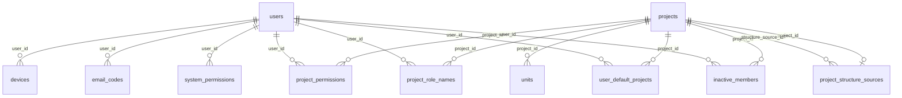
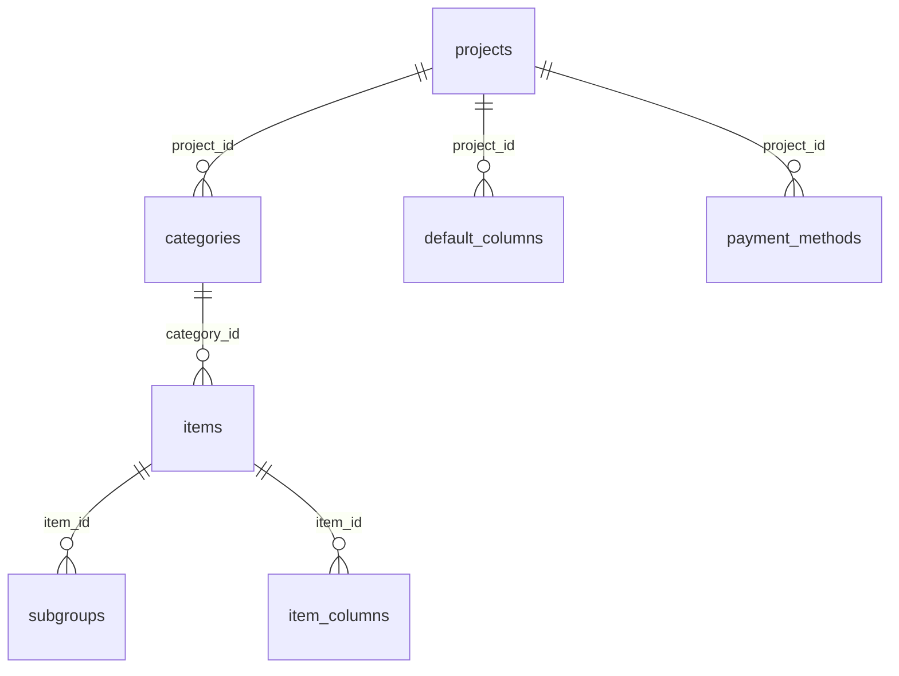
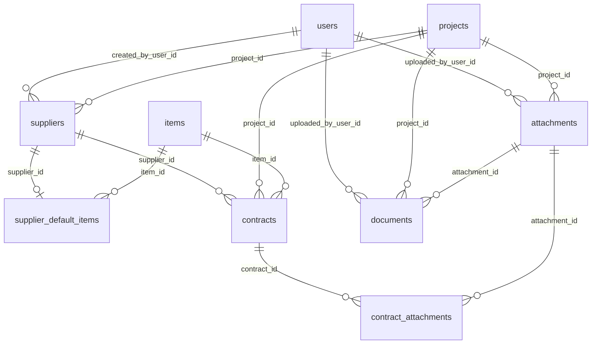
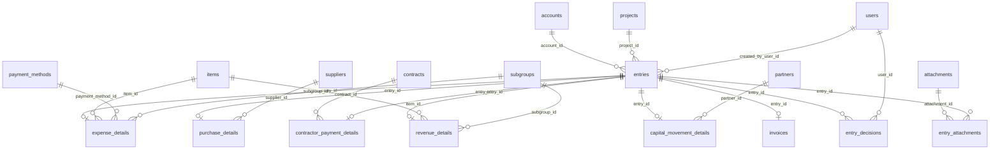
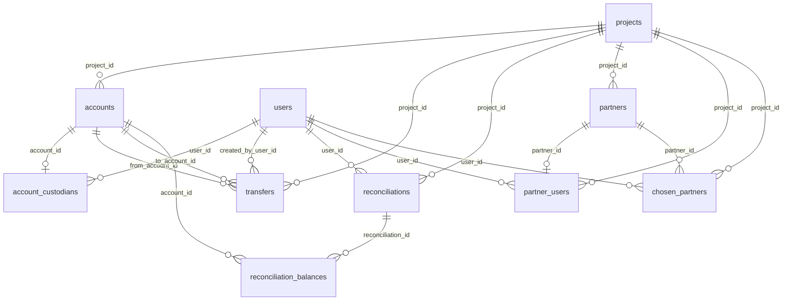
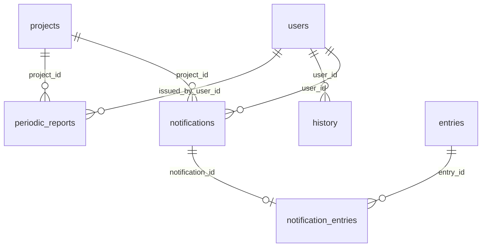
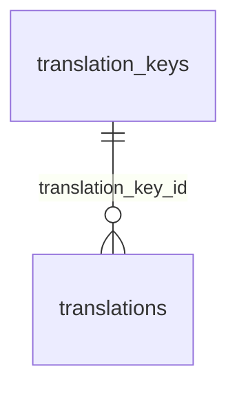

[Documentation](README.md) › Database

# Database

Every table, column, key and relation of the REDIX database on SQLite, as Go's migrations leave it (`go-backend/internal/db/migrations`, 00001 to 00006, the last adding a project's time zone, 17 Nov 2026). It was read from a database migrated from scratch, through SQLite's own catalog; `TestR19_ANewDatabaseHoldsEveryTableIndexAndTrigger` holds the migrations to it. When a migration changes the tables, this page changes in the same commit.

## What every table shares

| Rule | In the database |
| --- | --- |
| Every table is STRICT | A value of the wrong type is refused, and a text column's length is a `CHECK`, as the column's limit was on SQL Server |
| Names are snake_case (G9) | `project_id`, `vat_number`; the app and the API's JSON keep their camelCase names |
| No row version (N5) | SQLite writes one transaction at a time, so no row needs one |
| No column is NULL | An optional value is an empty value of its own type: `''`, `0`, `00000000-0000-0000-0000-000000000000` (none), or `1900-01-01T00:00:00.0000000Z` for a moment that has not happened; an optional id that names a row is a row in a link table, so it has its foreign key: `partner_users`, `notification_entries`, `project_structure_sources` (findings row 214) |
| Ids are UUIDs made in code | `TEXT`, version 7 (time-ordered), never made by the database; `history.id` and `entry_decisions.id` are `INTEGER` keys SQLite numbers in the order rows are written, and a lookup table's `id` is its enum's number |
| Times | `TEXT`, ISO 8601 in UTC with seven decimals (G10), so they sort as they happened; a date is `TEXT` `yyyy-mm-dd` |
| Money | `INTEGER` ten-thousandths (N6), so four decimals stay exact, rounded only in totals (BR-13) |
| Free JSON | `TEXT` holding JSON: a column's options, an entry's custom values, a report's snapshot, a History row's before and after |
| An enum column points at its lookup table | It stores the member's number, `INTEGER`, with a foreign key to `lk_{enum}.id`; `history.action` stores the name, with its foreign key to `lk_history_action.name`, so no History row changed |
| A foreign key never deletes for you | `NO ACTION`, except where a row only exists inside its owner: `account_custodians.account_id`, `devices.user_id`, `email_codes.user_id`, `notification_entries.notification_id`, `partner_users.partner_id`, `reconciliation_balances.reconciliation_id`, `supplier_default_items.supplier_id`, `translations.translation_key_id`, `units.project_id` cascade |
| History is never changed | Triggers refuse an update or a delete of a `history` row (AC-21.1, `TestAC21_1_HistoryIsNeverChangedOrDeleted`) |

49 tables hold the business, 13 are lookup tables, and `goose_db_version` is goose's list of the migrations applied.

## Incidents, a file of their own

Every answer of 400 or more is kept in `incidents.db`, a SQLite file beside the database (`REDIX_Incidents__Path`), not in it (redix-api #150): a
failing database must not lose the incident about it, and the replay that fails the database call by call must not count its writes. The API
makes its one table when it opens the file, and lets an incident go after 90 days. Never a password, a code or a file's content.

| Column | Type | Null | Key | Points at |
| --- | --- | --- | --- | --- |
| id | INTEGER | not null | PK | Numbered by SQLite in the order written |
| at | TEXT (a UTC moment) | not null |  |  |
| trace_id | TEXT (at most 55) | not null |  | The answer's `X-Trace-Id` and `traceId` |
| method | TEXT (at most 10) | not null |  |  |
| route | TEXT (at most 300) | not null |  | The path, each id named `{id}`; never the query |
| status | INTEGER | not null |  |  |
| code | TEXT (at most 60) | not null |  | The answer's code |
| user_id | TEXT (UUID, at most 36) | not null |  | Who asked, `''` before a sign-in; no key, so an incident is never refused |
| project_id | TEXT (UUID, at most 36) | not null |  | The route's project, `''` for none |
| duration_ms | INTEGER | not null |  |  |
| stack | TEXT (at most 20000) | not null |  | A panic's stack, `''` otherwise |

Other indexes: `at`; `trace_id`.

## Core and project tables

One SQLite file holds both sides (N9). A table whose rows belong to one project, by a `project_id` of its own or through the row it hangs from, is a project's table; every other table is REDIX's core. Each table's side is written over its `CREATE TABLE` in the migrations (`-- project.Accounts`, `-- dbo.Users`), as SQL Server's `project` and `dbo` schemas held them (redix-api #123), so that in release 2 the project tables can move to each project's own database.

| Side | Tables |
| --- | --- |
| Core (16, with the 13 lookup tables) | config_values, devices, email_codes, history, inactive_members, notification_entries, notifications, project_permissions, project_role_names, project_structure_sources, projects, system_permissions, translation_keys, translations, user_default_projects, users |
| A project's (33) | account_custodians, accounts, attachments, capital_movement_details, categories, chosen_partners, contract_attachments, contractor_payment_details, contracts, default_columns, documents, entries, entry_attachments, entry_decisions, expense_details, invoices, item_columns, items, partner_users, partners, payment_method_accounts, payment_methods, periodic_reports, project_time_zones, purchase_details, reconciliation_balances, reconciliations, revenue_details, subgroups, supplier_default_items, suppliers, transfers, units |

The core tables that name a project stay core: who may do what in which project is what lets a person sign in once and see the projects they belong to; History stays whole until release 2, and the notifications stay core, since the bell spans projects (D6).

## Lookup tables

One per enum the database stores, named `lk_{enum}`: `id` is the member's number (the primary key), `name` the member's name (unique); `lk_time_zone` holds only the names of the time zones a project may take. Their rows are seeded by the migrations, and `TestR31_ANewDatabaseStartsWithItsWordsAndLookups` proves a new database starts with them. A member no code writes any more stays while old rows hold it, such as `Reverse` in `lk_history_action`.

| Lookup table | `id` type | Held by |
| --- | --- | --- |
| [lk_account_type](#lk_account_type) | INTEGER | `accounts.type` |
| [lk_column_data_type](#lk_column_data_type) | INTEGER | `default_columns.data_type`, `item_columns.data_type` |
| [lk_email_code_purpose](#lk_email_code_purpose) | INTEGER | `email_codes.purpose` |
| [lk_entry_attachment_role](#lk_entry_attachment_role) | INTEGER | `entry_attachments.role` |
| [lk_entry_decision_action](#lk_entry_decision_action) | INTEGER | `entry_decisions.action` |
| [lk_entry_kind](#lk_entry_kind) | INTEGER | `entries.kind` |
| [lk_entry_status](#lk_entry_status) | INTEGER | `entries.status` |
| [lk_history_action](#lk_history_action) | INTEGER | `history.action` |
| [lk_item_type](#lk_item_type) | INTEGER | `default_columns.item_type`, `items.type` |
| [lk_permission_request_status](#lk_permission_request_status) | INTEGER | `permission_requests.status` |
| [lk_notification_kind](#lk_notification_kind) | INTEGER | `notifications.kind` |
| [lk_project_status](#lk_project_status) | INTEGER | `projects.status` |
| [lk_supplier_status](#lk_supplier_status) | INTEGER | `suppliers.status` |
| [lk_time_zone](#lk_time_zone) | TEXT | `project_time_zones.time_zone` |

### lk_account_type

| id | name | Meaning |
| --- | --- | --- |
| 0 | Bank | A bank account (حساب بنكي). |
| 1 | CashCustody | Cash held by one person (عهدة نقدية). |

### lk_column_data_type

| id | name | Meaning |
| --- | --- | --- |
| 0 | Text | Free text. |
| 1 | Number | A number, such as an area. |
| 2 | Amount | An amount of money. |
| 3 | Date | A date. |
| 4 | List | A choice from a list: its own, or a register such as the suppliers. |
| 5 | File | A picture or a PDF. |

### lk_entry_attachment_role

| id | name | Meaning |
| --- | --- | --- |
| 0 | Invoice | The invoice (FR-09). |
| 1 | Receipt | A receipt voucher. |
| 2 | BankReceipt | A bank transfer receipt. |
| 3 | Other | Anything else. |

### lk_email_code_purpose

| id | name | Meaning |
| --- | --- | --- |
| 0 | ResetPassword | Reset a forgotten password from the sign-in screen: the code goes to the account's email (AC-02.6). |
| 1 | ConfirmEmail | Make a new address the person's email, in Settings: the code goes to the new address (AC-10.4). |

### lk_entry_decision_action

| id | name | Meaning |
| --- | --- | --- |
| 0 | Submit | Sent for approval. |
| 1 | Approve | Approved: it counts. |
| 2 | Reject | Refused, saying why. |

### lk_entry_kind

| id | name | Meaning |
| --- | --- | --- |
| 0 | Purchase | A purchase from a supplier (FR-08). |
| 1 | ContractorPayment | A payment to a contractor (FR-12). |
| 2 | CapitalIn | Capital coming in from a partner. |
| 3 | CapitalOut | Capital going out to a partner. |
| 4 | Revenue | Revenue, such as a sale or a VAT refund. |

### lk_entry_status

| id | name | Meaning |
| --- | --- | --- |
| 0 | Draft | Saved by who entered it, and seen and handled by nobody else until it is sent (BR-42). |
| 1 | PendingApproval | Sent, and waiting for Finance. |
| 2 | Approved | Approved: it counts. |
| 3 | Rejected | Refused, saying why. |
| 4 | Removed | Removed after approval by whoever holds `RemoveApprovedEntries` (redix-api #119): kept in the database with its history, and read by no list and no figure. |

### lk_history_action

| id | name | Meaning |
| --- | --- | --- |
| 0 | SignIn | A user signed in on a new device (UC-002). |
| 1 | SignOut | A user signed out of a device (UC-062). |
| 2 | SignInFailed | A wrong password was typed for a user, or any password while they are locked or disabled; what was typed never enters the History table (UC-005). |
| 3 | AccountLocked | A wrong password locked a user's account (AC-01.2, UC-005). |
| 4 | ChangePassword | A user replaced their password (UC-003); the password's hash never enters the History table. |
| 5 | Create | A project manager created a user (UC-007, UC-009), Finance added a unit (UC-006), a contract (UC-020) or an account, someone saved an entry as a draft, or the parts of a new entry (UC-022), or moved money between two accounts (redix-app #89). |
| 6 | Update | A user's name or mobile was changed (UC-007), an account (UC-015), or a contract amended (UC-020). |
| 7 | ResetPassword | A user was given a new temporary password (UC-007). |
| 8 | Disable | A user, a contract or an account was disabled (UC-007, UC-020, redix-app #89). |
| 9 | Enable | A disabled user, contract or account was enabled (UC-007, UC-020, redix-app #89). |
| 10 | AssignProject | A user was given a permission in a project (UC-008, UC-009). |
| 11 | RemoveProject | A user's permission in a project was taken away (UC-008, UC-009). |
| 12 | RegisterProject | A project was registered, and waits for the admin (UC-066). |
| 13 | ApproveProject | The admin let a registered project in (UC-066). |
| 14 | Approve | Finance approved an entry, so it counts (UC-032). |
| 15 | Reject | Finance rejected an entry, saying why (UC-032). |
| 16 | RejectProject | The admin refused a registered project, saying why (UC-066). |
| 17 | TurnOnBiometrics | A user turned on fingerprint or face on a phone, so its session no longer times out (UC-011). |
| 18 | TurnOffBiometrics | A user turned off fingerprint or face on a phone, so its session times out again (UC-011). |
| 19 | Submit | An entry was sent for approval (UC-022). |
| 20 | Attach | A file was kept, or linked to a contract (UC-021). |
| 21 | CloseProject | A project was closed, which cannot be undone (UC-006). |
| 22 | Delete | A unit, a document, an account nothing named or an entry was deleted (redix-api #96, redix-app #89), or an approved entry removed softly (redix-api #119). |
| 23 | Restore | An approved entry removed softly was brought back, the undo of its removal (redix-api #119). |
| 24 | Reverse | An entry approved at once as the opposite of another, written by reversing before it went (redix-api #119, D5). Nothing writes it now; it stays because History rows never change (AC-21.1), and the histories read it as the approval of an ordinary entry. |
| 25 | Archive | A project's archive was taken, by whom (UC-073 R15). |
| 26 | Retrieve | A project was retrieved from an archive: one line standing for every row it put back, naming when the archive was taken (UC-073 D9). |

### lk_item_type

| id | name | Meaning |
| --- | --- | --- |
| 0 | Purchases | Purchases only. |
| 1 | ContractorPayments | Contractor payments only. |
| 2 | Both | Both purchases and contractor payments. |
| 3 | Sale | Revenue: money from a unit sold. |
| 4 | VatRefund | Revenue: VAT refunded, recorded like any other revenue (redix-api #96, D23). |
| 5 | OtherRevenue | Revenue: anything else that comes in. |
| 6 | Capital | Revenue: what the partners put in, less what they took out (BR-05, BR-06). Its tables are its partners, each a table as a contract is (redix-api #109). |

### lk_notification_kind

| id | name | Meaning |
| --- | --- | --- |
| 0 | EntrySubmitted | An entry was sent, and waits for a decision. |
| 1 | EntryApproved | The author's entry was approved. |
| 2 | EntryRejected | The author's entry was rejected. |
| 3 | ProjectApproved | The admin let the manager's project in. |
| 4 | ProjectRejected | The admin refused the manager's project. |
| 5 | PermissionRequested | Someone asked to change their permissions; told to whoever manages the project's users (redix-api #112). |
| 6 | PermissionRequestApproved | The person's permission request was approved (redix-api #112). |
| 7 | PermissionRequestRejected | The person's permission request was refused, with its reason (redix-api #112). |

### lk_permission_request_status

| id | name | Meaning |
| --- | --- | --- |
| 0 | Waiting | Asked, not decided; one per person per project. |
| 1 | Approved | Applied as ticking is. |
| 2 | Rejected | Refused, with its reason. |

### lk_project_status

| id | name | Meaning |
| --- | --- | --- |
| 0 | Active | Entries are recorded and approved. |
| 1 | Finished | Finished: read-only, with its reports still available (AC-04.1). |
| 2 | PendingApproval | Registered, and waiting for the admin; no permission counts in it yet (BR-34). |
| 3 | Rejected | The admin refused it, saying why; no permission counts in it (BR-34). |

### lk_supplier_status

| id | name | Meaning |
| --- | --- | --- |
| 0 | Approved | In the register, for anyone to use. |
| 1 | PendingApproval | Added from the field: it waits for the first expense on it to be approved (BR-30). |

### Not a lookup table yet: Permission

`project_permissions.permission` and `system_permissions.permission` store a permission by name, which a CHECK holds to the names below; `project_permissions` was rebuilt by migrations 00008 and 00009 when `SeeProjectHistory` and `ManageProjectFiles` joined, since SQLite cannot change a CHECK in place. In Go, `access.All` holds them, a new one last, since History keeps a permission as its place there. They have no lookup table, because redix-api #120 replaces them with a true/false column per permission. Their names:

| Name | Meaning |
| --- | --- |
| ApproveProjects | Sees the registered projects, and approves or rejects them (BR-29, BR-34). |
| ManageUsers | Adds people to one project and ticks their permissions in it (FR-02, BR-29). |
| ReadProject | Sees one project and everything in it (BR-31). |
| SeeAllCapital | Sees every partner in one project and their capital (BR-31). Holding it takes `see_chosen_capital` (redix-api #106). |
| SeeChosenCapital | Sees only the partners of one project chosen for them, and their capital (BR-31, redix-api #106). Holding it takes `see_all_capital`. |
| ManageProject | Renames one project, adds, renames and deletes its units, and closes it (FR-04, BR-38). |
| ManageStructure | Shapes one project's expense structure: its categories, items, subgroups and columns (FR-05, FR-38, FR-39, FR-41). |
| ManageSettings | Keeps one project's payment methods, accounts, partners, suppliers and contracts (FR-40, FR-22, UC-016, FR-06, FR-07). |
| AddSupplier | Adds a supplier to one project's register; without `manage_settings` it waits for approval (FR-44, BR-30). |
| ChargeAnyAccount | Spends from any active account of one project; without it, only from those the user holds (BRS open question 4). The entry use cases refuse the rest. |
| RecordEntries | Records a purchase or a contractor payment in one project's ledger (FR-08, FR-12). |
| ManageAnyEntry | Changes, sends again and deletes an entry someone else sent in one project, before approval; without it, only one's own (UC-028). Never someone else's draft (BR-42). |
| DeleteEntries | Deletes an entry of one project that is not approved: one's own draft or rejected entry, or with `manage_any_entry` anyone's sent entry or one waiting (UC-033, BR-42). |
| RemoveApprovedEntries | Removes an approved entry of one project softly (redix-api #119): it leaves every list and figure as if never approved, and stays in the database with its history. |
| AttachFiles | Keeps a picture or a PDF in one project, for an entry or a contract (FR-09). |
| ApproveEntries | Sees the entries waiting in one project, and approves or rejects them (FR-18, FR-19). |
| MoveMoney | Enters a project's capital movements and revenue from Add entry, which wait for approval like every entry, and reconciles its accounts (BR-30, FR-24, FR-25). |
| SeeReports | «يرى التقارير»: opens one project's reports, the periodic report, an item's report, a contract's and the VAT statement (redix-api #131). |
| GenerateReports | «يُصدر التقارير»: issues one project's next periodic report and takes every report's Excel and PDF, whose capital shows only the partners its holder may see (redix-api #131, BR-31). |
| SeeProjectHistory | «يرى سجل المشروع»: reads one project's history, every action in it, each line only for whoever may see its record (UC-069). |
| ManageProjectFiles | «ملفات المشروع»: takes one project's archive and retrieves one over it, and loads a project file (UC-073, UC-071); migration 00009 gave it to every ManageProject holder. |

### lk_time_zone

The time zones a project may take (redix-app #107), seeded from `internal/zones` (redix-api #87); `project_time_zones.time_zone` points at a name.

| name |
| --- |
| Africa/Cairo |
| America/Los_Angeles |
| America/New_York |
| Asia/Amman |
| Asia/Bahrain |
| Asia/Dhaka |
| Asia/Dubai |
| Asia/Karachi |
| Asia/Kolkata |
| Asia/Kuwait |
| Asia/Manila |
| Asia/Muscat |
| Asia/Qatar |
| Asia/Riyadh |
| Asia/Shanghai |
| Europe/Istanbul |
| Europe/London |
| Europe/Paris |

## The lookups and the columns that hold them

```mermaid
erDiagram
    lk_project_status ||--o{ projects : "status"
    lk_item_type ||--o{ items : "type"
    lk_column_data_type ||--o{ default_columns : "data_type"
    lk_item_type ||--o{ default_columns : "item_type"
    lk_column_data_type ||--o{ item_columns : "data_type"
    lk_supplier_status ||--o{ suppliers : "status"
    lk_entry_kind ||--o{ entries : "kind"
    lk_entry_status ||--o{ entries : "status"
    lk_entry_decision_action ||--o{ entry_decisions : "action"
    lk_entry_attachment_role ||--o{ entry_attachments : "role"
    lk_account_type ||--o{ accounts : "type"
    lk_history_action ||--o{ history : "action"
    lk_notification_kind ||--o{ notifications : "kind"
    lk_email_code_purpose ||--o{ email_codes : "purpose"
```

## People and projects

Who signs in, the projects, and who may do what in each.

### users

Everyone who signs in to REDIX.

| Column | Type | Null | Key | Points at |
| --- | --- | --- | --- | --- |
| id | TEXT (UUID) | not null | PK |  |
| username | TEXT | not null |  |  |
| display_name | TEXT (at most 100) | not null |  |  |
| mobile | TEXT (at most 20) | not null |  |  |
| password_hash | TEXT (at most 200) | not null |  |  |
| must_change_password | INTEGER (0 or 1) | not null |  |  |
| failed_sign_ins | INTEGER | not null |  |  |
| locked_until | TEXT (a UTC moment) | not null |  |  |
| created_at | TEXT (a UTC moment) | not null |  |  |
| email | TEXT | not null |  |  |

Unique: the key; `email` where `email<>''`; `username`.

### devices

The phones signed in, one per sign-in, each with its refresh token's hash.

| Column | Type | Null | Key | Points at |
| --- | --- | --- | --- | --- |
| id | TEXT (UUID) | not null | PK |  |
| user_id | TEXT (UUID) | not null | FK | `users.id` (cascade delete) |
| refresh_token_hash | TEXT (at most 64) | not null |  |  |
| refresh_expires_at | TEXT (a UTC moment) | not null |  |  |
| is_revoked | INTEGER (0 or 1) | not null |  |  |
| uses_biometrics | INTEGER (0 or 1) | not null |  |  |
| last_seen_at | TEXT (a UTC moment) | not null |  |  |

Unique: `refresh_token_hash`.

Other indexes: `user_id`.

### email_codes

The codes sent by email, each kept as its hash (redix-api #127): one per person and purpose, the last sent, which works once, for 15 minutes and 5 tries.

| Column | Type | Null | Key | Points at |
| --- | --- | --- | --- | --- |
| id | TEXT (UUID) | not null | PK |  |
| user_id | TEXT (UUID) | not null | FK | `users.id` (cascade delete) |
| purpose | INTEGER | not null | FK | `lk_email_code_purpose.id`: 0 ResetPassword, 1 ConfirmEmail |
| email | TEXT (at most 254) | not null |  |  |
| code_hash | TEXT (at most 200) | not null |  |  |
| expires_at | TEXT (a UTC moment) | not null |  |  |
| tries | INTEGER | not null |  |  |
| used_at | TEXT (a UTC moment) | not null |  |  |

Unique: the key only.

Other indexes: `user_id, purpose`; `purpose`.

### system_permissions

What a user may do across the system, such as the admin's approving projects.

| Column | Type | Null | Key | Points at |
| --- | --- | --- | --- | --- |
| id | TEXT (UUID) | not null | PK |  |
| user_id | TEXT (UUID) | not null | FK | `users.id` |
| permission | TEXT (at most 30) | not null |  | no foreign key: a `permission` name, held by the check `CK_SystemPermissions_Permission` (until redix-api #120) |

Unique: `user_id, permission`.

Check `CK_SystemPermissions_Permission`: `([permission]='generate_reports' OR [permission]='see_reports' OR [permission]='move_money' OR [permission]='approve_entries' OR [permission]='attach_files' OR [permission]='remove_approved_entries' OR [permission]='delete_entries' OR [permission]='manage_any_entry' OR [permission]='record_entries' OR [permission]='charge_any_account' OR [permission]='add_supplier' OR [permission]='manage_settings' OR [permission]='manage_structure' OR [permission]='manage_project' OR [permission]='see_chosen_capital' OR [permission]='see_all_capital' OR [permission]='read_project' OR [permission]='manage_users' OR [permission]='approve_projects')`.

### projects

The real-estate development projects; one row, `is_template`, is the default template every new project's structure is copied from.

| Column | Type | Null | Key | Points at |
| --- | --- | --- | --- | --- |
| id | TEXT (UUID) | not null | PK |  |
| name | TEXT (at most 100) | not null |  |  |
| start_date | TEXT (a date) | not null |  |  |
| status | INTEGER | not null | FK | `lk_project_status.id`: 0 Active, 1 Finished, 2 PendingApproval, 3 Rejected |
| rejection_reason | TEXT (at most 500) | not null |  |  |
| description | TEXT (at most 2000) | not null |  |  |
| is_template | INTEGER (0 or 1) | not null |  |  |
| last_entry_number | INTEGER | not null |  | The last «رقم القيد» the project gave, 0 before its first entry; moved up by one atomic `UPDATE … OUTPUT` as an entry is first kept (redix-api #128, D3) |

Unique: the key only.

Other indexes: `status`.

### project_time_zones

The time zone each project is in (redix-app #107, D1, D3): its entries' today is counted there, every moment staying UTC. A project with no row is in Asia/Riyadh, as every project was before. Its own table, since SQLite adds no column holding a foreign key and a default.

| Column | Type | Null | Key | Points at |
| --- | --- | --- | --- | --- |
| project_id | TEXT (UUID) | not null | PK FK | `projects.id` |
| time_zone | TEXT | not null | FK | `lk_time_zone.name` |

Unique: the key only.

Other indexes: `time_zone`.

### units

The units of a project, such as الفلة الغربية (FR-04).

| Column | Type | Null | Key | Points at |
| --- | --- | --- | --- | --- |
| id | TEXT (UUID) | not null | PK |  |
| project_id | TEXT (UUID) | not null | FK | `projects.id` (cascade delete) |
| name | TEXT (at most 100) | not null |  |  |
| sort_order | INTEGER | not null |  |  |

Unique: the key only.

Other indexes: `project_id`.

### project_permissions

Who may do what in which project: one row per permission ticked (FR-36).

| Column | Type | Null | Key | Points at |
| --- | --- | --- | --- | --- |
| id | TEXT (UUID) | not null | PK |  |
| project_id | TEXT (UUID) | not null | FK | `projects.id` |
| user_id | TEXT (UUID) | not null | FK | `users.id` |
| permission | TEXT (at most 30) | not null |  | no foreign key: a `permission` name, held by the check `CK_ProjectPermissions_Permission` (until redix-api #120) |

Unique: `project_id, user_id, permission`.

Other indexes: `user_id`.

Check `CK_ProjectPermissions_Permission`: `(([permission]='generate_reports' OR [permission]='see_reports' OR [permission]='move_money' OR [permission]='approve_entries' OR [permission]='attach_files' OR [permission]='remove_approved_entries' OR [permission]='delete_entries' OR [permission]='manage_any_entry' OR [permission]='record_entries' OR [permission]='charge_any_account' OR [permission]='add_supplier' OR [permission]='manage_settings' OR [permission]='manage_structure' OR [permission]='manage_project' OR [permission]='see_chosen_capital' OR [permission]='see_all_capital' OR [permission]='read_project' OR [permission]='manage_users' OR [permission]='approve_projects') AND [permission]<>'approve_projects')`.

### permission_requests

A person's request to change their own permissions in a project, and its decision (redix-api #112).

| Column | Type | Null | Key | Points at |
| --- | --- | --- | --- | --- |
| id | TEXT (UUID) | not null | PK |  |
| project_id | TEXT (UUID) | not null | FK | `projects.id` |
| user_id | TEXT (UUID) | not null | FK | `users.id`, who asked |
| gives | TEXT (JSON) | not null |  | the permissions asked for, by name |
| takes | TEXT (JSON) | not null |  | the permissions asked to give up, by name |
| reason | TEXT (at most 500) | not null |  | why |
| asked_at | TEXT (moment) | not null |  |  |
| status | INTEGER | not null | FK | `lk_permission_request_status.id` |
| rejection_reason | TEXT (at most 500) | not null |  | why it was refused; empty otherwise |

Unique: `project_id, user_id` where `status` is 0, one waiting request each.

Other indexes: `project_id, status`; `user_id`; `status`.

### project_role_names

What each person is called in each project, a label only (the owner, 9 Nov 2026).

| Column | Type | Null | Key | Points at |
| --- | --- | --- | --- | --- |
| id | TEXT (UUID) | not null | PK |  |
| project_id | TEXT (UUID) | not null | FK | `projects.id` |
| user_id | TEXT (UUID) | not null | FK | `users.id` |
| role_name | TEXT (at most 50) | not null |  |  |

Unique: `project_id, user_id`.

Other indexes: `user_id`.

### user_default_projects

The project each user chose to land on (FR-37), keyed by the user, as `account_custodians` is by its account (findings row 216).

| Column | Type | Null | Key | Points at |
| --- | --- | --- | --- | --- |
| user_id | TEXT (UUID) | not null | PK FK | `users.id` |
| project_id | TEXT (UUID) | not null | FK | `projects.id` |

Unique: the key only.

Other indexes: `project_id`.

### inactive_members

Who is inactive in which project (redix-api #126): a row means the person keeps his permissions and entries there and holds none of them until made active again; no row is active.

| Column | Type | Null | Key | Points at |
| --- | --- | --- | --- | --- |
| id | TEXT (UUID) | not null | PK |  |
| project_id | TEXT (UUID) | not null | FK | `projects.id` |
| user_id | TEXT (UUID) | not null | FK | `users.id` |

Unique: `project_id, user_id`.

Other indexes: `user_id`.

### project_structure_sources

The earlier project each registration chose to copy the structure from when it is approved (UC-012, findings row 214); no row copies the default template.

| Column | Type | Null | Key | Points at |
| --- | --- | --- | --- | --- |
| project_id | TEXT (UUID) | not null | PK FK | `projects.id` |
| structure_source_id | TEXT (UUID) | not null | FK | `projects.id` |

Unique: the key only.

Other indexes: `structure_source_id`.

## Structure and settings

What a project's entries are recorded against: categories, items, subgroups and columns, and how it pays.

### categories

Each project's categories, in the default template too (FR-39).

| Column | Type | Null | Key | Points at |
| --- | --- | --- | --- | --- |
| id | TEXT (UUID) | not null | PK |  |
| project_id | TEXT (UUID) | not null | FK | `projects.id` |
| name | TEXT (at most 100) | not null |  |  |
| sort_order | INTEGER | not null |  |  |
| is_active | INTEGER (0 or 1) | not null |  |  |

Unique: the key only.

Other indexes: `project_id`.

### items

The items under the categories, each of a type that says its side, expense or revenue (FR-05, FR-38).

| Column | Type | Null | Key | Points at |
| --- | --- | --- | --- | --- |
| id | TEXT (UUID) | not null | PK |  |
| category_id | TEXT (UUID) | not null | FK | `categories.id` |
| name | TEXT (at most 100) | not null |  |  |
| type | INTEGER | not null | FK | `lk_item_type.id`: 0 Purchases, 1 ContractorPayments, 2 Both, 3 Sale, 4 VatRefund, 5 OtherRevenue, 6 Capital |
| sort_order | INTEGER | not null |  |  |
| is_active | INTEGER (0 or 1) | not null |  |  |
| shows_table_percentages | INTEGER (0 or 1) | not null |  |  |

Unique: the key only.

Other indexes: `category_id`; `type`.

### subgroups

The groups inside an item, a general one in each (FR-05).

| Column | Type | Null | Key | Points at |
| --- | --- | --- | --- | --- |
| id | TEXT (UUID) | not null | PK |  |
| item_id | TEXT (UUID) | not null | FK | `items.id` |
| name | TEXT (at most 100) | not null |  |  |
| sort_order | INTEGER | not null |  |  |

Unique: the key only.

Other indexes: `item_id`.

### default_columns

What a new item of each type starts with, per project (FR-38, FR-41).

| Column | Type | Null | Key | Points at |
| --- | --- | --- | --- | --- |
| id | TEXT (UUID) | not null | PK |  |
| project_id | TEXT (UUID) | not null | FK | `projects.id` |
| item_type | INTEGER | not null | FK | `lk_item_type.id`: 0 Purchases, 1 ContractorPayments, 2 Both, 3 Sale, 4 VatRefund, 5 OtherRevenue, 6 Capital |
| key | TEXT (at most 50) | not null |  |  |
| name | TEXT (at most 100) | not null |  |  |
| data_type | INTEGER | not null | FK | `lk_column_data_type.id`: 0 Text, 1 Number, 2 Amount, 3 Date, 4 List, 5 File |
| is_core | INTEGER (0 or 1) | not null |  |  |
| is_required | INTEGER (0 or 1) | not null |  |  |
| show_in_reports | INTEGER (0 or 1) | not null |  |  |
| sort_order | INTEGER | not null |  |  |
| choices | TEXT (JSON) | not null |  |  |

Unique: `project_id, item_type, key`.

Other indexes: `data_type`; `item_type`.

### item_columns

What each item asks for at entry (FR-41).

| Column | Type | Null | Key | Points at |
| --- | --- | --- | --- | --- |
| id | TEXT (UUID) | not null | PK |  |
| item_id | TEXT (UUID) | not null | FK | `items.id` |
| is_hidden | INTEGER (0 or 1) | not null |  |  |
| key | TEXT (at most 50) | not null |  |  |
| name | TEXT (at most 100) | not null |  |  |
| data_type | INTEGER | not null | FK | `lk_column_data_type.id`: 0 Text, 1 Number, 2 Amount, 3 Date, 4 List, 5 File |
| is_core | INTEGER (0 or 1) | not null |  |  |
| is_required | INTEGER (0 or 1) | not null |  |  |
| show_in_reports | INTEGER (0 or 1) | not null |  |  |
| sort_order | INTEGER | not null |  |  |
| choices | TEXT (JSON) | not null |  |  |

Unique: `item_id, key`.

Other indexes: `data_type`.

### payment_methods

The ways each project pays (FR-40).

| Column | Type | Null | Key | Points at |
| --- | --- | --- | --- | --- |
| id | TEXT (UUID) | not null | PK |  |
| project_id | TEXT (UUID) | not null | FK | `projects.id` |
| name | TEXT (at most 100) | not null |  |  |
| sort_order | INTEGER | not null |  |  |
| is_active | INTEGER (0 or 1) | not null |  |  |

Unique: the key only.

Other indexes: `project_id`.

### payment_method_accounts

The accounts each payment method pays from (redix-app #109, D1), one row a pair. Every method kept before pays from every account its project has (R4), as an account added later is paid from by every method of its project (D1b), until someone unticks it.

| Column | Type | Null | Key | Points at |
| --- | --- | --- | --- | --- |
| payment_method_id | TEXT (UUID) | not null | PK FK | `payment_methods.id` |
| account_id | TEXT (UUID) | not null | PK FK | `accounts.id` |

Unique: the key only.

Other indexes: `account_id`.

## Suppliers, contracts and files

Who a project buys from, what its contractors were promised, and the files it keeps.

### suppliers

The supplier register of each project (FR-06).

| Column | Type | Null | Key | Points at |
| --- | --- | --- | --- | --- |
| id | TEXT (UUID) | not null | PK |  |
| project_id | TEXT (UUID) | not null | FK | `projects.id` |
| name | TEXT (at most 100) | not null |  |  |
| normalized_name | TEXT (at most 100) | not null |  |  |
| vat_number | TEXT (at most 20) | not null |  |  |
| mobile | TEXT (at most 20) | not null |  |  |
| status | INTEGER | not null | FK | `lk_supplier_status.id`: 0 Approved, 1 PendingApproval |
| is_active | INTEGER (0 or 1) | not null |  |  |
| is_general_cash | INTEGER (0 or 1) | not null |  |  |
| created_by_user_id | TEXT (UUID) | not null | FK | `users.id` |

Unique: the key; `project_id, vat_number` where `vat_number<>''`.

Other indexes: `created_by_user_id`; `project_id, name`; `status`.

### supplier_default_items

The item each supplier's expenses usually go to; one row at most per supplier.

| Column | Type | Null | Key | Points at |
| --- | --- | --- | --- | --- |
| supplier_id | TEXT (UUID) | not null | PK FK | `suppliers.id` (cascade delete) |
| item_id | TEXT (UUID) | not null | FK | `items.id` |

Unique: the key only.

Other indexes: `item_id`.

### contracts

What each project's contractors were promised (FR-07).

| Column | Type | Null | Key | Points at |
| --- | --- | --- | --- | --- |
| id | TEXT (UUID) | not null | PK |  |
| project_id | TEXT (UUID) | not null | FK | `projects.id` |
| item_id | TEXT (UUID) | not null | FK | `items.id` |
| sort_order | INTEGER | not null |  |  |
| supplier_id | TEXT (UUID) | not null | FK | `suppliers.id` |
| value | INTEGER (money, in ten-thousandths) | not null |  |  |
| is_open_value | INTEGER (0 or 1) | not null |  |  |
| unit_price | INTEGER (money, in ten-thousandths) | not null |  |  |
| quantity | INTEGER (money, in ten-thousandths) | not null |  |  |
| notes | TEXT (at most 1000) | not null |  |  |
| is_active | INTEGER (0 or 1) | not null |  |  |

Unique: the key only.

Other indexes: `item_id`; `project_id`; `supplier_id`.

### contract_attachments

The documents a contract carries (UC-020); a row stays once attached.

| Column | Type | Null | Key | Points at |
| --- | --- | --- | --- | --- |
| contract_id | TEXT (UUID) | not null | PK FK | `contracts.id` |
| attachment_id | TEXT (UUID) | not null | PK FK | `attachments.id` |

Unique: the key only.

Other indexes: `attachment_id`.

### attachments

The pictures and PDFs each project keeps (FR-09): the record of each file in the attachment folder.

| Column | Type | Null | Key | Points at |
| --- | --- | --- | --- | --- |
| id | TEXT (UUID) | not null | PK |  |
| project_id | TEXT (UUID) | not null | FK | `projects.id` |
| storage_path | TEXT (at most 200) | not null |  |  |
| file_name | TEXT (at most 255) | not null |  |  |
| content_type | TEXT (at most 255) | not null |  |  |
| size_bytes | INTEGER | not null |  |  |
| sha256 | TEXT (at most 64) | not null |  |  |
| uploaded_by_user_id | TEXT (UUID) | not null | FK | `users.id` |
| uploaded_at | TEXT (a UTC moment) | not null |  |  |

Unique: the key only.

Other indexes: `project_id, sha256`; `uploaded_by_user_id`.

### documents

A project's documents: a file of the attachment store kept under a name, in an optional group (UC-064).

| Column | Type | Null | Key | Points at |
| --- | --- | --- | --- | --- |
| id | TEXT (UUID) | not null | PK |  |
| project_id | TEXT (UUID) | not null | FK | `projects.id` |
| attachment_id | TEXT (UUID) | not null | FK | `attachments.id` |
| name | TEXT (at most 200) | not null |  |  |
| group_name | TEXT (at most 100) | not null |  |  |
| uploaded_by_user_id | TEXT (UUID) | not null | FK | `users.id` |
| uploaded_at | TEXT (a UTC moment) | not null |  |  |

Unique: `project_id, attachment_id`.

Other indexes: `attachment_id`; `uploaded_by_user_id`.

## The ledger

Every entry, the details of each kind, its approval steps and its files.

### entries

The ledger: every movement of money, of any kind; each kind's own fields are in a detail table keyed by the entry.

| Column | Type | Null | Key | Points at |
| --- | --- | --- | --- | --- |
| id | TEXT (UUID) | not null | PK |  |
| project_id | TEXT (UUID) | not null | FK | `projects.id` |
| kind | INTEGER | not null | FK | `lk_entry_kind.id`: 0 Purchase, 1 ContractorPayment, 2 CapitalIn, 3 CapitalOut, 4 Revenue |
| status | INTEGER | not null | FK | `lk_entry_status.id`: 0 Draft, 1 PendingApproval, 2 Approved, 3 Rejected, 4 Removed |
| entry_date | TEXT (a date) | not null |  |  |
| amount | INTEGER (money, in ten-thousandths) | not null |  |  |
| account_id | TEXT (UUID) | not null | FK | `accounts.id` |
| description | TEXT (at most 2000) | not null |  |  |
| created_by_user_id | TEXT (UUID) | not null | FK | `users.id` |
| created_at | TEXT (a UTC moment) | not null |  |  |
| approved_at | TEXT (a UTC moment) | not null |  |  |
| column_values | TEXT (JSON) | not null |  |  |
| number | INTEGER | not null |  | «رقم القيد», its number in its project, never changed (redix-api #128); the entries before it were numbered by date, then creation |

Unique: the key; `project_id, number`.

Other indexes: `account_id`; `created_by_user_id`; `kind`; `project_id, created_at, number` (a page of entries in their order, #87); `project_id, status`; `status`.

### expense_details

What every expense (a purchase or a contractor payment) has.

| Column | Type | Null | Key | Points at |
| --- | --- | --- | --- | --- |
| entry_id | TEXT (UUID) | not null | PK FK | `entries.id` |
| item_id | TEXT (UUID) | not null | FK | `items.id` |
| subgroup_id | TEXT (UUID) | not null | FK | `subgroups.id` |
| payment_method_id | TEXT (UUID) | not null | FK | `payment_methods.id` |

Unique: the key only.

Other indexes: `item_id`; `payment_method_id`; `subgroup_id`.

### purchase_details

A purchase's supplier, a row only when it names one: the supplier is optional (redix-api #129).

| Column | Type | Null | Key | Points at |
| --- | --- | --- | --- | --- |
| entry_id | TEXT (UUID) | not null | PK FK | `entries.id` |
| supplier_id | TEXT (UUID) | not null | FK | `suppliers.id` |

Unique: the key only.

Other indexes: `supplier_id`.

### contractor_payment_details

What only a contractor payment has.

| Column | Type | Null | Key | Points at |
| --- | --- | --- | --- | --- |
| entry_id | TEXT (UUID) | not null | PK FK | `entries.id` |
| contract_id | TEXT (UUID) | not null | FK | `contracts.id` |
| is_outside_contract | INTEGER (0 or 1) | not null |  |  |

Unique: the key only.

Other indexes: `contract_id`.

### revenue_details

What only revenue has: the revenue item it came in on (FR-28, FR-38).

| Column | Type | Null | Key | Points at |
| --- | --- | --- | --- | --- |
| entry_id | TEXT (UUID) | not null | PK FK | `entries.id` |
| item_id | TEXT (UUID) | not null | FK | `items.id` |
| subgroup_id | TEXT (UUID) | not null | FK | `subgroups.id` |

Unique: the key only.

Other indexes: `item_id`; `subgroup_id`.

### capital_movement_details

What only a capital movement has: the partner (FR-25). Whether money went in or out is its entry's kind, which the choice of «نوع الحركة» in its column values decides (redix-api #129).

| Column | Type | Null | Key | Points at |
| --- | --- | --- | --- | --- |
| entry_id | TEXT (UUID) | not null | PK FK | `entries.id` |
| partner_id | TEXT (UUID) | not null | FK | `partners.id` |

Unique: the key only.

Other indexes: `partner_id`.

### invoices

The bill numbers of expenses entered before REDIX stopped asking for one (redix-api #96, D2).

| Column | Type | Null | Key | Points at |
| --- | --- | --- | --- | --- |
| entry_id | TEXT (UUID) | not null | PK FK | `entries.id` |
| number | TEXT (at most 50) | not null |  |  |

Unique: the key only.

Other indexes: `number`.

### entry_decisions

Each entry's steps through approval: sent, approved, rejected.

| Column | Type | Null | Key | Points at |
| --- | --- | --- | --- | --- |
| id | INTEGER | null | PK |  |
| entry_id | TEXT (UUID) | not null | FK | `entries.id` |
| action | INTEGER | not null | FK | `lk_entry_decision_action.id`: 0 Submit, 1 Approve, 2 Reject |
| user_id | TEXT (UUID) | not null | FK | `users.id` |
| at | TEXT (a UTC moment) | not null |  |  |
| reason | TEXT (at most 500) | not null |  |  |

Unique: the key only.

Other indexes: `action`; `entry_id`; `user_id`.

### entry_attachments

The files each entry carries, and what each file is to it.

| Column | Type | Null | Key | Points at |
| --- | --- | --- | --- | --- |
| entry_id | TEXT (UUID) | not null | PK FK | `entries.id` |
| attachment_id | TEXT (UUID) | not null | PK FK | `attachments.id` |
| role | INTEGER | not null | FK | `lk_entry_attachment_role.id`: 0 Invoice, 1 Receipt, 2 BankReceipt, 3 Other |

Unique: the key only.

Other indexes: `attachment_id`; `role`.

## Money: accounts, transfers, reconciliations and partners

Where the money sits, how it moves between accounts, the checks against the books, and the partners whose capital it is.

### accounts

Where each project's money sits: a bank account or a cash custody (FR-22).

| Column | Type | Null | Key | Points at |
| --- | --- | --- | --- | --- |
| id | TEXT (UUID) | not null | PK |  |
| project_id | TEXT (UUID) | not null | FK | `projects.id` |
| type | INTEGER | not null | FK | `lk_account_type.id`: 0 Bank, 1 CashCustody |
| name | TEXT (at most 100) | not null |  |  |
| is_active | INTEGER (0 or 1) | not null |  |  |

Unique: the key only.

Other indexes: `project_id`; `type`.

### account_custodians

Who holds which account; one row at most per account.

| Column | Type | Null | Key | Points at |
| --- | --- | --- | --- | --- |
| account_id | TEXT (UUID) | not null | PK FK | `accounts.id` (cascade delete) |
| user_id | TEXT (UUID) | not null | FK | `users.id` |

Unique: the key only.

Other indexes: `user_id`.

### transfers

Money moved between two accounts of a project (FR-23): counted in both balances, never in the surplus.

| Column | Type | Null | Key | Points at |
| --- | --- | --- | --- | --- |
| id | TEXT (UUID) | not null | PK |  |
| project_id | TEXT (UUID) | not null | FK | `projects.id` |
| from_account_id | TEXT (UUID) | not null | FK | `accounts.id` |
| to_account_id | TEXT (UUID) | not null | FK | `accounts.id` |
| amount | INTEGER (money, in ten-thousandths) | not null |  | no foreign key: a `permission` name, held by the check `CK_Transfers_Amount` (until redix-api #120) |
| date | TEXT (a date) | not null |  |  |
| notes | TEXT (at most 1000) | not null |  |  |
| created_by_user_id | TEXT (UUID) | not null | FK | `users.id` |
| created_at | TEXT (a UTC moment) | not null |  |  |

Unique: the key only.

Other indexes: `created_by_user_id`; `from_account_id`; `project_id`; `to_account_id`.

Check `CK_Transfers_Amount`: `([amount]>(0))`.

Check `CK_Transfers_TwoAccounts`: `([from_account_id]<>[to_account_id])`.

### reconciliations

Each check of the accounts against the books.

| Column | Type | Null | Key | Points at |
| --- | --- | --- | --- | --- |
| id | TEXT (UUID) | not null | PK |  |
| project_id | TEXT (UUID) | not null | FK | `projects.id` |
| at | TEXT (a UTC moment) | not null |  |  |
| user_id | TEXT (UUID) | not null | FK | `users.id` |

Unique: the key only.

Other indexes: `project_id, at`; `user_id`.

### reconciliation_balances

What one account really held at a reconciliation; named in the plural as every other table is since findings row 215.

| Column | Type | Null | Key | Points at |
| --- | --- | --- | --- | --- |
| reconciliation_id | TEXT (UUID) | not null | PK FK | `reconciliations.id` (cascade delete) |
| account_id | TEXT (UUID) | not null | PK FK | `accounts.id` |
| actual_balance | INTEGER (money, in ten-thousandths) | not null |  |  |

Unique: the key only.

Other indexes: `account_id`.

### partners

The partners of each project (UC-016); each is a table of the project's one capital item (redix-api #109), which no partner stores: it is read from the project (`ProjectStructure.CapitalItemOf`, the owner, 16 Nov 2026).

| Column | Type | Null | Key | Points at |
| --- | --- | --- | --- | --- |
| id | TEXT (UUID) | not null | PK |  |
| project_id | TEXT (UUID) | not null | FK | `projects.id` |
| name | TEXT (at most 100) | not null |  |  |
| sort_order | INTEGER | not null |  |  |
| is_deleted | INTEGER (0 or 1) | not null |  |  |

Unique: the key only.

Other indexes: `project_id`.

### partner_users

Each partner's own login, for those who have one (findings row 214): whose account the partner is. A deleted partner keeps none, so a login is one kept partner's in a project.

| Column | Type | Null | Key | Points at |
| --- | --- | --- | --- | --- |
| partner_id | TEXT (UUID) | not null | PK FK | `partners.id` (cascade delete) |
| project_id | TEXT (UUID) | not null | FK | `projects.id` |
| user_id | TEXT (UUID) | not null | FK | `users.id` |

Unique: `project_id, user_id`.

Other indexes: `user_id`.

### unseen_groups

The groups each person does not see in each project, unticked by a manager (redix-api #106): what is kept is what is not seen, so a group added later is seen by everyone.

| Column | Type | Null | Key | Points at |
| --- | --- | --- | --- | --- |
| id | TEXT (UUID) | not null | PK |  |
| project_id | TEXT (UUID) | not null | FK | `projects.id` |
| user_id | TEXT (UUID) | not null | FK | `users.id` |
| subgroup_id | TEXT (UUID) | not null | FK | `subgroups.id`, deleted with it |

Unique: `project_id, user_id, subgroup_id`.

Other indexes: `subgroup_id`; `user_id`.

### unseen_contracts

The contracts each person does not see in each project, as `unseen_groups` keeps the groups (redix-api #106).

| Column | Type | Null | Key | Points at |
| --- | --- | --- | --- | --- |
| id | TEXT (UUID) | not null | PK |  |
| project_id | TEXT (UUID) | not null | FK | `projects.id` |
| user_id | TEXT (UUID) | not null | FK | `users.id` |
| contract_id | TEXT (UUID) | not null | FK | `contracts.id`, deleted with it |

Unique: `project_id, user_id, contract_id`.

Other indexes: `contract_id`; `user_id`.

The view `entry_tables` names each entry's table, the one owner every sum reads: a contractor's payment is its contract's, any other expense or revenue its group's; a capital movement has none (redix-api #106 G1).

### chosen_partners

Which partners each person sees in each project, beside seeing them all (BR-31, redix-api #106).

| Column | Type | Null | Key | Points at |
| --- | --- | --- | --- | --- |
| id | TEXT (UUID) | not null | PK |  |
| project_id | TEXT (UUID) | not null | FK | `projects.id` |
| user_id | TEXT (UUID) | not null | FK | `users.id` |
| partner_id | TEXT (UUID) | not null | FK | `partners.id` |

Unique: `project_id, user_id, partner_id`.

Other indexes: `partner_id`; `user_id`.

## Reports, history and notifications

What was issued, what was done, and who was told.

### periodic_reports

Each numbered periodic report as it was issued, with its snapshot (BR-26).

| Column | Type | Null | Key | Points at |
| --- | --- | --- | --- | --- |
| id | TEXT (UUID) | not null | PK |  |
| project_id | TEXT (UUID) | not null | FK | `projects.id` |
| number | INTEGER | not null |  |  |
| issued_at | TEXT (a UTC moment) | not null |  |  |
| issued_by_user_id | TEXT (UUID) | not null | FK | `users.id` |
| expenses_total | INTEGER (money, in ten-thousandths) | not null |  |  |
| snapshot | TEXT (JSON) | not null |  |  |

Unique: `project_id, number`.

Other indexes: `issued_by_user_id`.

### history

Who did what to which record, when, and in which project (FR-21); append-only: the trigger `HistoryIsAppendOnly` refuses any UPDATE or DELETE (AC-21.1).

| Column | Type | Null | Key | Points at |
| --- | --- | --- | --- | --- |
| id | INTEGER | null | PK |  |
| at | TEXT (a UTC moment) | not null |  |  |
| project_id | TEXT (UUID) | not null |  | no foreign key: the project the record belongs to; empty for one outside any project, such as a user |
| user_id | TEXT (UUID) | not null | FK | `users.id` |
| action | TEXT (at most 30) | not null | FK | `lk_history_action.name` (by name) |
| table_name | TEXT (at most 128) | not null |  |  |
| record_id | TEXT (UUID) | not null |  | no foreign key: the id of the record in `table_name` it was done to |
| before | TEXT (JSON) | not null |  |  |
| after | TEXT (JSON) | not null |  |  |
| trace_id | TEXT | not null |  | The trace id of the request that wrote it (redix-api #150), the same on every line of one request (UC-069); `''` before 18 Nov 2026 |

Unique: the key only.

Other indexes: `action`; `project_id, id`; `user_id`; `table_name, record_id`, for «سجلي».

Trigger `HistoryIsAppendOnly`: refuses any UPDATE or DELETE.

### notifications

What each person was told about an entry or a project (UC-036).

| Column | Type | Null | Key | Points at |
| --- | --- | --- | --- | --- |
| id | TEXT (UUID) | not null | PK |  |
| user_id | TEXT (UUID) | not null | FK | `users.id` |
| project_id | TEXT (UUID) | not null | FK | `projects.id` |
| kind | INTEGER | not null | FK | `lk_notification_kind.id`: 0 EntrySubmitted, 1 EntryApproved, 2 EntryRejected, 3 ProjectApproved, 4 ProjectRejected |
| at | TEXT (a UTC moment) | not null |  |  |
| is_read | INTEGER (0 or 1) | not null |  |  |

Unique: the key only.

Other indexes: `kind`; `project_id`; `user_id, at`.

### notification_entries

The entry each notification about one opens (findings row 214); a notification about the project itself has no row.

| Column | Type | Null | Key | Points at |
| --- | --- | --- | --- | --- |
| notification_id | TEXT (UUID) | not null | PK FK | `notifications.id` (cascade delete) |
| entry_id | TEXT (UUID) | not null | FK | `entries.id` |

Unique: the key only.

Other indexes: `entry_id`.

## Words and configuration

The words the app shows and the values that may change while the API runs.

### translation_keys

Every word the app shows, by key.

| Column | Type | Null | Key | Points at |
| --- | --- | --- | --- | --- |
| id | TEXT (UUID) | not null | PK |  |
| key | TEXT (at most 100) | not null |  |  |
| description | TEXT (at most 500) | not null |  |  |

Unique: `key`.

### translations

The value of one word in one language.

| Column | Type | Null | Key | Points at |
| --- | --- | --- | --- | --- |
| id | TEXT (UUID) | not null | PK |  |
| translation_key_id | TEXT (UUID) | not null | FK | `translation_keys.id` (cascade delete) |
| language | TEXT (at most 2) | not null |  |  |
| value | TEXT (at most 1000) | not null |  |  |

Unique: `translation_key_id, language`.

Other indexes: `language` (#87).

### config_values

The configurable values, such as how long the app waits for an answer (UC-070).

| Column | Type | Null | Key | Points at |
| --- | --- | --- | --- | --- |
| id | TEXT (UUID) | not null | PK |  |
| key | TEXT (at most 100) | not null |  |  |
| value | TEXT (at most 500) | not null |  |  |

Unique: `key`.
