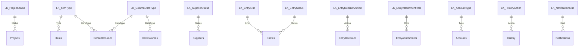
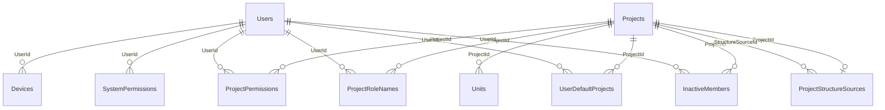
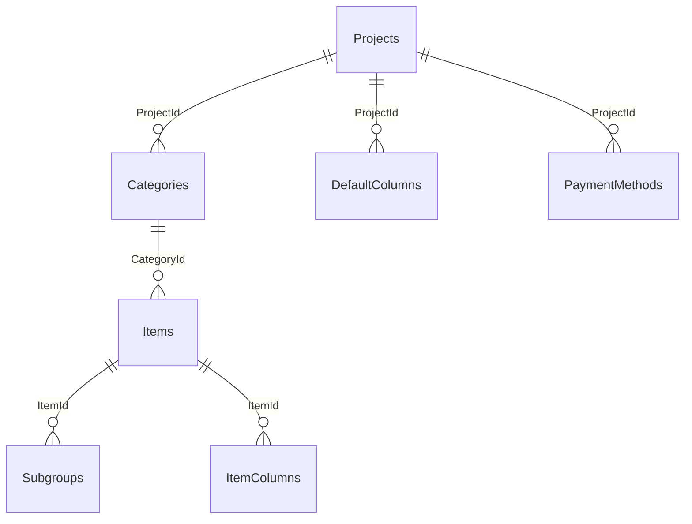
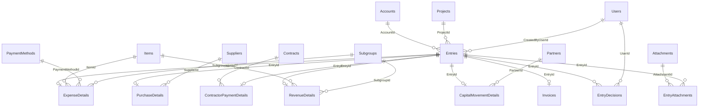
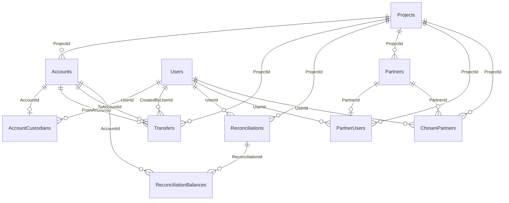
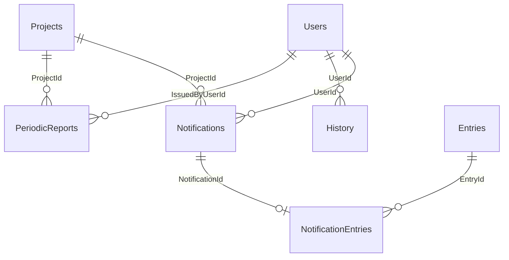
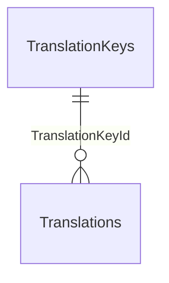

[Documentation](README.md) › Database

# Database

Every table, column, key and relation of the REDIX database as it stands after the migration `ProjectSchema` (15 Nov 2026, redix-api #123). It was read from a database migrated from scratch, through SQL Server's own catalog, and matches the EF Core model in `RedixDbContext.OnModelCreating` and `Migrations/RedixDbContextModelSnapshot.cs`. When the model changes, this page changes in the same commit.

## What every table shares

| Rule | In the database |
| --- | --- |
| Each table is in its side's schema | REDIX's core in `dbo`; every table whose rows belong to one project in `project` (redix-api #123): see [Schemas](#schemas) |
| Every table has a required `RowVersion` | `rowversion not null`, for sync and concurrency; it is left out of the tables below |
| No column is NULL | An optional value is an empty value of its own type: `''`, `0`, `00000000-0000-0000-0000-000000000000` (none), or `1900-01-01` for a moment that has not happened; an optional id that names a row is a row in a link table, so it has its foreign key: `PartnerUsers`, `NotificationEntries`, `ProjectStructureSources` (findings row 214) |
| Ids are GUIDs made in code | `uniqueidentifier`, time-ordered (`Guid.CreateVersion7`), never made by the database; `History.Id` and `EntryDecisions.Id` are `bigint identity`, numbered in the order rows are written, and a lookup table's `Id` is its enum's number |
| Money | `decimal(19,4)`, rounded only in totals (BR-13) |
| Free JSON | `json`: a column's options, an entry's custom values, a report's snapshot, a History row's before and after |
| An enum column points at its lookup table | It stores the member's number, `tinyint`, with a foreign key to `LK_{enum}.Id`; `History.Action` stores the name, `varchar(30)`, with its foreign key to `LK_HistoryAction.Name`, so no History row changed; the two permission columns store names held by a check constraint until redix-api #120 |
| A foreign key never deletes for you | `NO ACTION` (EF Core's `Restrict`), except where a row only exists inside its owner: an account's custodian, a partner's login, a notification's entry, a phone, a reconciliation's balances, a supplier's default item, a word's translations and a project's units cascade |

46 tables hold the business, 11 are lookup tables, and `__EFMigrationsHistory` is EF Core's list of the migrations applied.

## Schemas

One database, two schemas (redix-api #123, step 1). A table whose rows belong to one project, by a `ProjectId` of its own or through the row it hangs from, is marked `IProjectRow` in its class, and `RedixDbContext` keeps it in `project`; every other table is REDIX's core, in `dbo`. The migration `ProjectSchema` moved the 31 with `ALTER SCHEMA … TRANSFER`, so no row moved and every key stayed. `SchemaTests` proves each table is in its side's schema, and fails when a table holding a `ProjectId`, or a key to a project's table, declares no side. In release 2 the `project` tables move to each project's own database.

| Schema | Tables |
| --- | --- |
| `dbo` (26) | Users, Devices, SystemPermissions, Projects, ProjectPermissions, InactiveMembers, ProjectRoleNames, UserDefaultProjects, ProjectStructureSources, ConfigValues, TranslationKeys, Translations, History, Notifications, NotificationEntries, and the 11 lookup tables; with them `__EFMigrationsHistory` |
| `project` (31) | Accounts, AccountCustodians, Transfers, Reconciliations, ReconciliationBalances, Categories, Items, Subgroups, ItemColumns, DefaultColumns, PaymentMethods, Suppliers, SupplierDefaultItems, Contracts, ContractAttachments, Entries, ExpenseDetails, PurchaseDetails, ContractorPaymentDetails, RevenueDetails, CapitalMovementDetails, EntryDecisions, EntryAttachments, Invoices, Attachments, Documents, Partners, ChosenPartners, PartnerUsers, PeriodicReports, Units |

The core tables that name a project stay core: who may do what in which project is what lets a person sign in once and see the projects they belong to; History stays whole until release 2, and the notifications stay core, since the bell spans projects (D6).

## Lookup tables

One per enum the database stores, named `LK_{enum}`: `Id` is the member's number (the primary key, the same SQL type as the columns that hold it), `Name` the member's name (unique). Its rows are seeded from the enum itself (`RedixDbContext.HasLookup`), so they cannot drift from the code; `LookupTablesTests` proves that every enum column points at its table and that each table holds exactly its enum's members. A member no code writes any more stays while old rows hold it, such as `HistoryAction.Reverse`.

| Lookup table | `Id` type | Held by |
| --- | --- | --- |
| [LK_AccountType](#lk_accounttype) | tinyint | `Accounts.Type` |
| [LK_ColumnDataType](#lk_columndatatype) | tinyint | `DefaultColumns.DataType`, `ItemColumns.DataType` |
| [LK_EntryAttachmentRole](#lk_entryattachmentrole) | tinyint | `EntryAttachments.Role` |
| [LK_EntryDecisionAction](#lk_entrydecisionaction) | tinyint | `EntryDecisions.Action` |
| [LK_EntryKind](#lk_entrykind) | tinyint | `Entries.Kind` |
| [LK_EntryStatus](#lk_entrystatus) | tinyint | `Entries.Status` |
| [LK_HistoryAction](#lk_historyaction) | int | `History.Action` (by name) |
| [LK_ItemType](#lk_itemtype) | tinyint | `Items.Type`, `DefaultColumns.ItemType` |
| [LK_NotificationKind](#lk_notificationkind) | tinyint | `Notifications.Kind` |
| [LK_ProjectStatus](#lk_projectstatus) | tinyint | `Projects.Status` |
| [LK_SupplierStatus](#lk_supplierstatus) | tinyint | `Suppliers.Status` |

### LK_AccountType

| Id | Name | Meaning |
| --- | --- | --- |
| 0 | Bank | A bank account (حساب بنكي). |
| 1 | CashCustody | Cash held by one person (عهدة نقدية). |

### LK_ColumnDataType

| Id | Name | Meaning |
| --- | --- | --- |
| 0 | Text | Free text. |
| 1 | Number | A number, such as an area. |
| 2 | Amount | An amount of money. |
| 3 | Date | A date. |
| 4 | List | A choice from a list: its own, or a register such as the suppliers. |
| 5 | File | A picture or a PDF. |

### LK_EntryAttachmentRole

| Id | Name | Meaning |
| --- | --- | --- |
| 0 | Invoice | The invoice (FR-09). |
| 1 | Receipt | A receipt voucher. |
| 2 | BankReceipt | A bank transfer receipt. |
| 3 | Other | Anything else. |

### LK_EntryDecisionAction

| Id | Name | Meaning |
| --- | --- | --- |
| 0 | Submit | Sent for approval. |
| 1 | Approve | Approved: it counts. |
| 2 | Reject | Refused, saying why. |

### LK_EntryKind

| Id | Name | Meaning |
| --- | --- | --- |
| 0 | Purchase | A purchase from a supplier (FR-08). |
| 1 | ContractorPayment | A payment to a contractor (FR-12). |
| 2 | CapitalIn | Capital coming in from a partner. |
| 3 | CapitalOut | Capital going out to a partner. |
| 4 | Revenue | Revenue, such as a sale or a VAT refund. |

### LK_EntryStatus

| Id | Name | Meaning |
| --- | --- | --- |
| 0 | Draft | Saved by who entered it, and seen and handled by nobody else until it is sent (BR-42). |
| 1 | PendingApproval | Sent, and waiting for Finance. |
| 2 | Approved | Approved: it counts. |
| 3 | Rejected | Refused, saying why. |
| 4 | Removed | Removed after approval by whoever holds `RemoveApprovedEntries` (redix-api #119): kept in the database with its history, and read by no list and no figure. |

### LK_HistoryAction

| Id | Name | Meaning |
| --- | --- | --- |
| 0 | SignIn | A user signed in on a new device (UC-002). |
| 1 | SignOut | A user signed out of a device (UC-062). |
| 2 | SignInFailed | A wrong password was typed for a user, or any password while they are locked or disabled; what was typed never enters the History table (UC-005). |
| 3 | AccountLocked | A wrong password locked a user's account (AC-01.2, UC-005). |
| 4 | ChangePassword | A user replaced their password (UC-003); the password's hash never enters the History table. |
| 5 | Create | A project manager created a user (UC-007, UC-009), Finance added a unit (UC-006), a contract (UC-020) or an account, someone saved an entry as a draft, or the parts of a new entry (UC-022), or moved money between two accounts (redix-app #89). |
| 6 | Update | A user's name or mobile was changed (UC-007), an account (UC-015), or a contract amended (UC-020). |
| 7 | ResetPassword | A user was given a new temporary password (UC-007). |
| 8 | Disable | A user, a contract or an account was disabled (UC-007, UC-020, redix-app #89). |
| 9 | Enable | A disabled user, contract or account was enabled (UC-007, UC-020, redix-app #89). |
| 10 | AssignProject | A user was given a permission in a project (UC-008, UC-009). |
| 11 | RemoveProject | A user's permission in a project was taken away (UC-008, UC-009). |
| 12 | RegisterProject | A project was registered, and waits for the admin (UC-066). |
| 13 | ApproveProject | The admin let a registered project in (UC-066). |
| 14 | Approve | Finance approved an entry, so it counts (UC-032). |
| 15 | Reject | Finance rejected an entry, saying why (UC-032). |
| 16 | RejectProject | The admin refused a registered project, saying why (UC-066). |
| 17 | TurnOnBiometrics | A user turned on fingerprint or face on a phone, so its session no longer times out (UC-011). |
| 18 | TurnOffBiometrics | A user turned off fingerprint or face on a phone, so its session times out again (UC-011). |
| 19 | Submit | An entry was sent for approval (UC-022). |
| 20 | Attach | A file was kept, or linked to a contract (UC-021). |
| 21 | CloseProject | A project was closed, which cannot be undone (UC-006). |
| 22 | Delete | A unit, a document, an account nothing named or an entry was deleted (redix-api #96, redix-app #89), or an approved entry removed softly (redix-api #119). |
| 23 | Restore | An approved entry removed softly was brought back, the undo of its removal (redix-api #119). |
| 24 | Reverse | An entry approved at once as the opposite of another, written by reversing before it went (redix-api #119, D5). Nothing writes it now; it stays because History rows never change (AC-21.1), and the histories read it as the approval of an ordinary entry. |

### LK_ItemType

| Id | Name | Meaning |
| --- | --- | --- |
| 0 | Purchases | Purchases only. |
| 1 | ContractorPayments | Contractor payments only. |
| 2 | Both | Both purchases and contractor payments. |
| 3 | Sale | Revenue: money from a unit sold. |
| 4 | VatRefund | Revenue: VAT refunded, recorded like any other revenue (redix-api #96, D23). |
| 5 | OtherRevenue | Revenue: anything else that comes in. |
| 6 | Capital | Revenue: what the partners put in, less what they took out (BR-05, BR-06). Its tables are its partners, each a table as a contract is (redix-api #109). |

### LK_NotificationKind

| Id | Name | Meaning |
| --- | --- | --- |
| 0 | EntrySubmitted | An entry was sent, and waits for a decision. |
| 1 | EntryApproved | The author's entry was approved. |
| 2 | EntryRejected | The author's entry was rejected. |
| 3 | ProjectApproved | The admin let the manager's project in. |
| 4 | ProjectRejected | The admin refused the manager's project. |

### LK_ProjectStatus

| Id | Name | Meaning |
| --- | --- | --- |
| 0 | Active | Entries are recorded and approved. |
| 1 | Finished | Finished: read-only, with its reports still available (AC-04.1). |
| 2 | PendingApproval | Registered, and waiting for the admin; no permission counts in it yet (BR-34). |
| 3 | Rejected | The admin refused it, saying why; no permission counts in it (BR-34). |

### LK_SupplierStatus

| Id | Name | Meaning |
| --- | --- | --- |
| 0 | Approved | In the register, for anyone to use. |
| 1 | PendingApproval | Added from the field: it waits for the first expense on it to be approved (BR-30). |

### Not a lookup table yet: Permission

`ProjectPermissions.Permission` and `SystemPermissions.Permission` store a `Permission` by name, held by a check constraint rather than a lookup table, because redix-api #120 replaces them with a true/false column per permission. Their names:

| Name | Meaning |
| --- | --- |
| ApproveProjects | Sees the registered projects, and approves or rejects them (BR-29, BR-34). |
| ManageUsers | Adds people to one project and ticks their permissions in it (FR-02, BR-29). |
| ReadProject | Sees one project and everything in it (BR-31). |
| SeeAllCapital | Sees every partner in one project and their capital (BR-31). Holding it takes `SeeChosenCapital` (redix-api #106). |
| SeeChosenCapital | Sees only the partners of one project chosen for them, and their capital (BR-31, redix-api #106). Holding it takes `SeeAllCapital`. |
| ManageProject | Renames one project, adds, renames and deletes its units, and closes it (FR-04, BR-38). |
| ManageStructure | Shapes one project's expense structure: its categories, items, subgroups and columns (FR-05, FR-38, FR-39, FR-41). |
| ManageSettings | Keeps one project's payment methods, accounts, partners, suppliers and contracts (FR-40, FR-22, UC-016, FR-06, FR-07). |
| AddSupplier | Adds a supplier to one project's register; without `ManageSettings` it waits for approval (FR-44, BR-30). |
| ChargeAnyAccount | Spends from any active account of one project; without it, only from those the user holds (BRS open question 4). The entry use cases refuse the rest. |
| RecordEntries | Records a purchase or a contractor payment in one project's ledger (FR-08, FR-12). |
| ManageAnyEntry | Changes, sends again and deletes an entry someone else sent in one project, before approval; without it, only one's own (UC-028). Never someone else's draft (BR-42). |
| DeleteEntries | Deletes an entry of one project that is not approved: one's own draft or rejected entry, or with `ManageAnyEntry` anyone's sent entry or one waiting (UC-033, BR-42). |
| RemoveApprovedEntries | Removes an approved entry of one project softly (redix-api #119): it leaves every list and figure as if never approved, and stays in the database with its history. |
| AttachFiles | Keeps a picture or a PDF in one project, for an entry or a contract (FR-09). |
| ApproveEntries | Sees the entries waiting in one project, and approves or rejects them (FR-18, FR-19). |
| MoveMoney | Enters a project's capital movements and revenue from Add entry, which wait for approval like every entry, and reconciles its accounts (BR-30, FR-24, FR-25). |
| SeeReports | «يرى التقارير»: opens one project's reports, the periodic report, an item's report, a contract's and the VAT statement (redix-api #131). |
| GenerateReports | «يُصدر التقارير»: issues one project's next periodic report and takes every report's Excel and PDF, whose capital shows only the partners its holder may see (redix-api #131, BR-31). |

## The lookups and the columns that hold them

## People and projects

Who signs in, the projects, and who may do what in each.

### Users

Everyone who signs in to REDIX.

| Column | SQL type | Null | Key | Points at |
| --- | --- | --- | --- | --- |
| Id | uniqueidentifier | not null | PK |  |
| Username | nvarchar(50) | not null |  |  |
| PasswordHash | varchar(200) | not null |  |  |
| MustChangePassword | bit | not null |  |  |
| FailedSignIns | int | not null |  |  |
| LockedUntil | datetime2(7) | not null |  |  |
| CreatedAt | datetime2(7) | not null |  |  |
| DisplayName | nvarchar(100) | not null |  |  |
| Mobile | varchar(20) | not null |  |  |

Unique: `Username`.

### Devices

The phones signed in, one per sign-in, each with its refresh token's hash.

| Column | SQL type | Null | Key | Points at |
| --- | --- | --- | --- | --- |
| Id | uniqueidentifier | not null | PK |  |
| UserId | uniqueidentifier | not null | FK | `Users.Id` (cascade delete) |
| RefreshTokenHash | char(64) | not null |  |  |
| RefreshExpiresAt | datetime2(7) | not null |  |  |
| IsRevoked | bit | not null |  |  |
| LastSeenAt | datetime2(7) | not null |  |  |
| UsesBiometrics | bit | not null |  |  |

Unique: `RefreshTokenHash`.

Other indexes: `UserId`.

### SystemPermissions

What a user may do across the system, such as the admin's approving projects.

| Column | SQL type | Null | Key | Points at |
| --- | --- | --- | --- | --- |
| Id | uniqueidentifier | not null | PK |  |
| UserId | uniqueidentifier | not null | FK | `Users.Id` |
| Permission | varchar(30) | not null |  | no foreign key: a `Permission` name, held by the check `CK_SystemPermissions_Permission` (until redix-api #120) |

Unique: `UserId, Permission`.

Check `CK_SystemPermissions_Permission`: `([Permission]='GenerateReports' OR [Permission]='SeeReports' OR [Permission]='MoveMoney' OR [Permission]='ApproveEntries' OR [Permission]='AttachFiles' OR [Permission]='RemoveApprovedEntries' OR [Permission]='DeleteEntries' OR [Permission]='ManageAnyEntry' OR [Permission]='RecordEntries' OR [Permission]='ChargeAnyAccount' OR [Permission]='AddSupplier' OR [Permission]='ManageSettings' OR [Permission]='ManageStructure' OR [Permission]='ManageProject' OR [Permission]='SeeChosenCapital' OR [Permission]='SeeAllCapital' OR [Permission]='ReadProject' OR [Permission]='ManageUsers' OR [Permission]='ApproveProjects')`.

### Projects

The real-estate development projects; one row, `IsTemplate`, is the default template every new project's structure is copied from.

| Column | SQL type | Null | Key | Points at |
| --- | --- | --- | --- | --- |
| Id | uniqueidentifier | not null | PK |  |
| Name | nvarchar(100) | not null |  |  |
| StartDate | date | not null |  |  |
| Status | tinyint | not null | FK | `LK_ProjectStatus.Id`: 0 Active, 1 Finished, 2 PendingApproval, 3 Rejected |
| RejectionReason | nvarchar(500) | not null |  |  |
| IsTemplate | bit | not null |  |  |
| Description | nvarchar(2000) | not null |  |  |

Unique: the key only.

Other indexes: `Status`.

### Units

The units of a project, such as الفلة الغربية (FR-04).

| Column | SQL type | Null | Key | Points at |
| --- | --- | --- | --- | --- |
| Id | uniqueidentifier | not null | PK |  |
| ProjectId | uniqueidentifier | not null | FK | `Projects.Id` (cascade delete) |
| Name | nvarchar(100) | not null |  |  |
| SortOrder | int | not null |  |  |

Unique: the key only.

Other indexes: `ProjectId`.

### ProjectPermissions

Who may do what in which project: one row per permission ticked (FR-36).

| Column | SQL type | Null | Key | Points at |
| --- | --- | --- | --- | --- |
| Id | uniqueidentifier | not null | PK |  |
| ProjectId | uniqueidentifier | not null | FK | `Projects.Id` |
| UserId | uniqueidentifier | not null | FK | `Users.Id` |
| Permission | varchar(30) | not null |  | no foreign key: a `Permission` name, held by the check `CK_ProjectPermissions_Permission` (until redix-api #120) |

Unique: `ProjectId, UserId, Permission`.

Other indexes: `UserId`.

Check `CK_ProjectPermissions_Permission`: `(([Permission]='GenerateReports' OR [Permission]='SeeReports' OR [Permission]='MoveMoney' OR [Permission]='ApproveEntries' OR [Permission]='AttachFiles' OR [Permission]='RemoveApprovedEntries' OR [Permission]='DeleteEntries' OR [Permission]='ManageAnyEntry' OR [Permission]='RecordEntries' OR [Permission]='ChargeAnyAccount' OR [Permission]='AddSupplier' OR [Permission]='ManageSettings' OR [Permission]='ManageStructure' OR [Permission]='ManageProject' OR [Permission]='SeeChosenCapital' OR [Permission]='SeeAllCapital' OR [Permission]='ReadProject' OR [Permission]='ManageUsers' OR [Permission]='ApproveProjects') AND [Permission]<>'ApproveProjects')`.

### ProjectRoleNames

What each person is called in each project, a label only (Muteb, 9 Nov 2026).

| Column | SQL type | Null | Key | Points at |
| --- | --- | --- | --- | --- |
| Id | uniqueidentifier | not null | PK |  |
| ProjectId | uniqueidentifier | not null | FK | `Projects.Id` |
| UserId | uniqueidentifier | not null | FK | `Users.Id` |
| RoleName | nvarchar(50) | not null |  |  |

Unique: `ProjectId, UserId`.

Other indexes: `UserId`.

### UserDefaultProjects

The project each user chose to land on (FR-37), keyed by the user, as `AccountCustodians` is by its account (findings row 216).

| Column | SQL type | Null | Key | Points at |
| --- | --- | --- | --- | --- |
| UserId | uniqueidentifier | not null | PK FK | `Users.Id` |
| ProjectId | uniqueidentifier | not null | FK | `Projects.Id` |

Unique: the key only.

Other indexes: `ProjectId`.

### InactiveMembers

Who is inactive in which project (redix-api #126): a row means the person keeps his permissions and entries there and holds none of them until made active again; no row is active.

| Column | SQL type | Null | Key | Points at |
| --- | --- | --- | --- | --- |
| Id | uniqueidentifier | not null | PK |  |
| ProjectId | uniqueidentifier | not null | FK | `Projects.Id` |
| UserId | uniqueidentifier | not null | FK | `Users.Id` |

Unique: `ProjectId, UserId`.

Other indexes: `UserId`.

### ProjectStructureSources

The earlier project each registration chose to copy the structure from when it is approved (UC-012, findings row 214); no row copies the default template.

| Column | SQL type | Null | Key | Points at |
| --- | --- | --- | --- | --- |
| ProjectId | uniqueidentifier | not null | PK FK | `Projects.Id` |
| StructureSourceId | uniqueidentifier | not null | FK | `Projects.Id` |

Unique: the key only.

Other indexes: `StructureSourceId`.

## Structure and settings

What a project's entries are recorded against: categories, items, subgroups and columns, and how it pays.

### Categories

Each project's categories, in the default template too (FR-39).

| Column | SQL type | Null | Key | Points at |
| --- | --- | --- | --- | --- |
| Id | uniqueidentifier | not null | PK |  |
| ProjectId | uniqueidentifier | not null | FK | `Projects.Id` |
| Name | nvarchar(100) | not null |  |  |
| SortOrder | int | not null |  |  |
| IsActive | bit | not null |  |  |

Unique: the key only.

Other indexes: `ProjectId`.

### Items

The items under the categories, each of a type that says its side, expense or revenue (FR-05, FR-38).

| Column | SQL type | Null | Key | Points at |
| --- | --- | --- | --- | --- |
| Id | uniqueidentifier | not null | PK |  |
| CategoryId | uniqueidentifier | not null | FK | `Categories.Id` |
| Name | nvarchar(100) | not null |  |  |
| Type | tinyint | not null | FK | `LK_ItemType.Id`: 0 Purchases, 1 ContractorPayments, 2 Both, 3 Sale, 4 VatRefund, 5 OtherRevenue, 6 Capital |
| SortOrder | int | not null |  |  |
| IsActive | bit | not null |  |  |
| ShowsTablePercentages | bit | not null |  |  |

Unique: the key only.

Other indexes: `CategoryId`; `Type`.

### Subgroups

The groups inside an item, a general one in each (FR-05).

| Column | SQL type | Null | Key | Points at |
| --- | --- | --- | --- | --- |
| Id | uniqueidentifier | not null | PK |  |
| ItemId | uniqueidentifier | not null | FK | `Items.Id` |
| Name | nvarchar(100) | not null |  |  |
| SortOrder | int | not null |  |  |

Unique: the key only.

Other indexes: `ItemId`.

### DefaultColumns

What a new item of each type starts with, per project (FR-38, FR-41).

| Column | SQL type | Null | Key | Points at |
| --- | --- | --- | --- | --- |
| Id | uniqueidentifier | not null | PK |  |
| ProjectId | uniqueidentifier | not null | FK | `Projects.Id` |
| ItemType | tinyint | not null | FK | `LK_ItemType.Id`: 0 Purchases, 1 ContractorPayments, 2 Both, 3 Sale, 4 VatRefund, 5 OtherRevenue, 6 Capital |
| Key | varchar(50) | not null |  |  |
| Name | nvarchar(100) | not null |  |  |
| DataType | tinyint | not null | FK | `LK_ColumnDataType.Id`: 0 Text, 1 Number, 2 Amount, 3 Date, 4 List, 5 File |
| IsCore | bit | not null |  |  |
| IsRequired | bit | not null |  |  |
| ShowInReports | bit | not null |  |  |
| SortOrder | int | not null |  |  |
| Choices | json | not null |  |  |

Unique: `ProjectId, ItemType, Key`.

Other indexes: `DataType`; `ItemType`.

### ItemColumns

What each item asks for at entry (FR-41).

| Column | SQL type | Null | Key | Points at |
| --- | --- | --- | --- | --- |
| Id | uniqueidentifier | not null | PK |  |
| ItemId | uniqueidentifier | not null | FK | `Items.Id` |
| IsHidden | bit | not null |  |  |
| Key | varchar(50) | not null |  |  |
| Name | nvarchar(100) | not null |  |  |
| DataType | tinyint | not null | FK | `LK_ColumnDataType.Id`: 0 Text, 1 Number, 2 Amount, 3 Date, 4 List, 5 File |
| IsCore | bit | not null |  |  |
| IsRequired | bit | not null |  |  |
| ShowInReports | bit | not null |  |  |
| SortOrder | int | not null |  |  |
| Choices | json | not null |  |  |

Unique: `ItemId, Key`.

Other indexes: `DataType`.

### PaymentMethods

The ways each project pays (FR-40).

| Column | SQL type | Null | Key | Points at |
| --- | --- | --- | --- | --- |
| Id | uniqueidentifier | not null | PK |  |
| ProjectId | uniqueidentifier | not null | FK | `Projects.Id` |
| Name | nvarchar(100) | not null |  |  |
| SortOrder | int | not null |  |  |
| IsActive | bit | not null |  |  |

Unique: the key only.

Other indexes: `ProjectId`.

## Suppliers, contracts and files

Who a project buys from, what its contractors were promised, and the files it keeps.

### Suppliers

The supplier register of each project (FR-06).

| Column | SQL type | Null | Key | Points at |
| --- | --- | --- | --- | --- |
| Id | uniqueidentifier | not null | PK |  |
| ProjectId | uniqueidentifier | not null | FK | `Projects.Id` |
| Name | nvarchar(100) | not null |  |  |
| VatNumber | varchar(20) | not null |  |  |
| Mobile | varchar(20) | not null |  |  |
| Status | tinyint | not null | FK | `LK_SupplierStatus.Id`: 0 Approved, 1 PendingApproval |
| IsActive | bit | not null |  |  |
| CreatedByUserId | uniqueidentifier | not null | FK | `Users.Id` |
| IsGeneralCash | bit | not null |  |  |
| NormalizedName | nvarchar(100) | not null |  |  |

Unique: `ProjectId, VatNumber where ([VatNumber]<>'')`.

Other indexes: `CreatedByUserId`; `ProjectId, Name`; `Status`.

### SupplierDefaultItems

The item each supplier's expenses usually go to; one row at most per supplier.

| Column | SQL type | Null | Key | Points at |
| --- | --- | --- | --- | --- |
| SupplierId | uniqueidentifier | not null | PK FK | `Suppliers.Id` (cascade delete) |
| ItemId | uniqueidentifier | not null | FK | `Items.Id` |

Unique: the key only.

Other indexes: `ItemId`.

### Contracts

What each project's contractors were promised (FR-07).

| Column | SQL type | Null | Key | Points at |
| --- | --- | --- | --- | --- |
| Id | uniqueidentifier | not null | PK |  |
| ProjectId | uniqueidentifier | not null | FK | `Projects.Id` |
| ItemId | uniqueidentifier | not null | FK | `Items.Id` |
| SupplierId | uniqueidentifier | not null | FK | `Suppliers.Id` |
| Value | decimal(19,4) | not null |  |  |
| IsOpenValue | bit | not null |  |  |
| UnitPrice | decimal(19,4) | not null |  |  |
| Quantity | decimal(19,4) | not null |  |  |
| Notes | nvarchar(1000) | not null |  |  |
| IsActive | bit | not null |  |  |
| SortOrder | int | not null |  |  |

Unique: the key only.

Other indexes: `ItemId`; `ProjectId`; `SupplierId`.

### ContractAttachments

The documents a contract carries (UC-020); a row stays once attached.

| Column | SQL type | Null | Key | Points at |
| --- | --- | --- | --- | --- |
| ContractId | uniqueidentifier | not null | PK FK | `Contracts.Id` |
| AttachmentId | uniqueidentifier | not null | PK FK | `Attachments.Id` |

Unique: the key only.

Other indexes: `AttachmentId`.

### Attachments

The pictures and PDFs each project keeps (FR-09): the record of each file in the attachment folder.

| Column | SQL type | Null | Key | Points at |
| --- | --- | --- | --- | --- |
| Id | uniqueidentifier | not null | PK |  |
| ProjectId | uniqueidentifier | not null | FK | `Projects.Id` |
| StoragePath | varchar(200) | not null |  |  |
| FileName | nvarchar(255) | not null |  |  |
| ContentType | varchar(255) | not null |  |  |
| SizeBytes | int | not null |  |  |
| Sha256 | char(64) | not null |  |  |
| UploadedByUserId | uniqueidentifier | not null | FK | `Users.Id` |
| UploadedAt | datetime2(7) | not null |  |  |

Unique: the key only.

Other indexes: `ProjectId, Sha256`; `UploadedByUserId`.

### Documents

A project's documents: a file of the attachment store kept under a name, in an optional group (UC-064).

| Column | SQL type | Null | Key | Points at |
| --- | --- | --- | --- | --- |
| Id | uniqueidentifier | not null | PK |  |
| ProjectId | uniqueidentifier | not null | FK | `Projects.Id` |
| AttachmentId | uniqueidentifier | not null | FK | `Attachments.Id` |
| Name | nvarchar(200) | not null |  |  |
| UploadedByUserId | uniqueidentifier | not null | FK | `Users.Id` |
| UploadedAt | datetime2(7) | not null |  |  |
| Group | nvarchar(100) | not null |  |  |

Unique: `ProjectId, AttachmentId`.

Other indexes: `AttachmentId`; `UploadedByUserId`.

## The ledger

Every entry, the details of each kind, its approval steps and its files.

### Entries

The ledger: every movement of money, of any kind; each kind's own fields are in a detail table keyed by the entry.

| Column | SQL type | Null | Key | Points at |
| --- | --- | --- | --- | --- |
| Id | uniqueidentifier | not null | PK |  |
| ProjectId | uniqueidentifier | not null | FK | `Projects.Id` |
| Kind | tinyint | not null | FK | `LK_EntryKind.Id`: 0 Purchase, 1 ContractorPayment, 2 CapitalIn, 3 CapitalOut, 4 Revenue |
| Status | tinyint | not null | FK | `LK_EntryStatus.Id`: 0 Draft, 1 PendingApproval, 2 Approved, 3 Rejected, 4 Removed |
| EntryDate | date | not null |  |  |
| Amount | decimal(19,4) | not null |  |  |
| AccountId | uniqueidentifier | not null | FK | `Accounts.Id` |
| Description | nvarchar(2000) | not null |  |  |
| ColumnValues | json | not null |  |  |
| CreatedByUserId | uniqueidentifier | not null | FK | `Users.Id` |
| CreatedAt | datetime2(7) | not null |  |  |
| ApprovedAt | datetime2(7) | not null |  |  |

Unique: the key only.

Other indexes: `AccountId`; `CreatedByUserId`; `Kind`; `ProjectId, Status including Kind, Amount, AccountId`; `Status`.

### ExpenseDetails

What every expense (a purchase or a contractor payment) has.

| Column | SQL type | Null | Key | Points at |
| --- | --- | --- | --- | --- |
| EntryId | uniqueidentifier | not null | PK FK | `Entries.Id` |
| ItemId | uniqueidentifier | not null | FK | `Items.Id` |
| SubgroupId | uniqueidentifier | not null | FK | `Subgroups.Id` |
| PaymentMethodId | uniqueidentifier | not null | FK | `PaymentMethods.Id` |

Unique: the key only.

Other indexes: `ItemId`; `PaymentMethodId`; `SubgroupId`.

### PurchaseDetails

A purchase's supplier, a row only when it names one: the supplier is optional (redix-api #129).

| Column | SQL type | Null | Key | Points at |
| --- | --- | --- | --- | --- |
| EntryId | uniqueidentifier | not null | PK FK | `Entries.Id` |
| SupplierId | uniqueidentifier | not null | FK | `Suppliers.Id` |

Unique: the key only.

Other indexes: `SupplierId`.

### ContractorPaymentDetails

What only a contractor payment has.

| Column | SQL type | Null | Key | Points at |
| --- | --- | --- | --- | --- |
| EntryId | uniqueidentifier | not null | PK FK | `Entries.Id` |
| ContractId | uniqueidentifier | not null | FK | `Contracts.Id` |
| IsOutsideContract | bit | not null |  |  |

Unique: the key only.

Other indexes: `ContractId`.

### RevenueDetails

What only revenue has: the revenue item it came in on (FR-28, FR-38).

| Column | SQL type | Null | Key | Points at |
| --- | --- | --- | --- | --- |
| EntryId | uniqueidentifier | not null | PK FK | `Entries.Id` |
| ItemId | uniqueidentifier | not null | FK | `Items.Id` |
| SubgroupId | uniqueidentifier | not null | FK | `Subgroups.Id` |

Unique: the key only.

Other indexes: `ItemId`; `SubgroupId`.

### CapitalMovementDetails

What only a capital movement has: the partner (FR-25). Whether money went in or out is its entry's kind, which the choice of «نوع الحركة» in its column values decides (redix-api #129).

| Column | SQL type | Null | Key | Points at |
| --- | --- | --- | --- | --- |
| EntryId | uniqueidentifier | not null | PK FK | `Entries.Id` |
| PartnerId | uniqueidentifier | not null | FK | `Partners.Id` |

Unique: the key only.

Other indexes: `PartnerId`.

### Invoices

The bill numbers of expenses entered before REDIX stopped asking for one (redix-api #96, D2).

| Column | SQL type | Null | Key | Points at |
| --- | --- | --- | --- | --- |
| EntryId | uniqueidentifier | not null | PK FK | `Entries.Id` |
| Number | nvarchar(50) | not null |  |  |

Unique: the key only.

Other indexes: `Number`.

### EntryDecisions

Each entry's steps through approval: sent, approved, rejected.

| Column | SQL type | Null | Key | Points at |
| --- | --- | --- | --- | --- |
| Id | bigint identity | not null | PK |  |
| EntryId | uniqueidentifier | not null | FK | `Entries.Id` |
| Action | tinyint | not null | FK | `LK_EntryDecisionAction.Id`: 0 Submit, 1 Approve, 2 Reject |
| UserId | uniqueidentifier | not null | FK | `Users.Id` |
| At | datetime2(7) | not null |  |  |
| Reason | nvarchar(500) | not null |  |  |

Unique: the key only.

Other indexes: `Action`; `EntryId`; `UserId`.

### EntryAttachments

The files each entry carries, and what each file is to it.

| Column | SQL type | Null | Key | Points at |
| --- | --- | --- | --- | --- |
| EntryId | uniqueidentifier | not null | PK FK | `Entries.Id` |
| AttachmentId | uniqueidentifier | not null | PK FK | `Attachments.Id` |
| Role | tinyint | not null | FK | `LK_EntryAttachmentRole.Id`: 0 Invoice, 1 Receipt, 2 BankReceipt, 3 Other |

Unique: the key only.

Other indexes: `AttachmentId`; `Role`.

## Money: accounts, transfers, reconciliations and partners

Where the money sits, how it moves between accounts, the checks against the books, and the partners whose capital it is.

### Accounts

Where each project's money sits: a bank account or a cash custody (FR-22).

| Column | SQL type | Null | Key | Points at |
| --- | --- | --- | --- | --- |
| Id | uniqueidentifier | not null | PK |  |
| ProjectId | uniqueidentifier | not null | FK | `Projects.Id` |
| Type | tinyint | not null | FK | `LK_AccountType.Id`: 0 Bank, 1 CashCustody |
| Name | nvarchar(100) | not null |  |  |
| IsActive | bit | not null |  |  |

Unique: the key only.

Other indexes: `ProjectId`; `Type`.

### AccountCustodians

Who holds which account; one row at most per account.

| Column | SQL type | Null | Key | Points at |
| --- | --- | --- | --- | --- |
| AccountId | uniqueidentifier | not null | PK FK | `Accounts.Id` (cascade delete) |
| UserId | uniqueidentifier | not null | FK | `Users.Id` |

Unique: the key only.

Other indexes: `UserId`.

### Transfers

Money moved between two accounts of a project (FR-23): counted in both balances, never in the surplus.

| Column | SQL type | Null | Key | Points at |
| --- | --- | --- | --- | --- |
| Id | uniqueidentifier | not null | PK |  |
| ProjectId | uniqueidentifier | not null | FK | `Projects.Id` |
| FromAccountId | uniqueidentifier | not null | FK | `Accounts.Id` |
| ToAccountId | uniqueidentifier | not null | FK | `Accounts.Id` |
| Amount | decimal(19,4) | not null |  | no foreign key: a `Permission` name, held by the check `CK_Transfers_Amount` (until redix-api #120) |
| Date | date | not null |  |  |
| Notes | nvarchar(1000) | not null |  |  |
| CreatedByUserId | uniqueidentifier | not null | FK | `Users.Id` |
| CreatedAt | datetime2(7) | not null |  |  |

Unique: the key only.

Other indexes: `CreatedByUserId`; `FromAccountId`; `ProjectId`; `ToAccountId`.

Check `CK_Transfers_Amount`: `([Amount]>(0))`.

Check `CK_Transfers_TwoAccounts`: `([FromAccountId]<>[ToAccountId])`.

### Reconciliations

Each check of the accounts against the books.

| Column | SQL type | Null | Key | Points at |
| --- | --- | --- | --- | --- |
| Id | uniqueidentifier | not null | PK |  |
| ProjectId | uniqueidentifier | not null | FK | `Projects.Id` |
| At | datetime2(7) | not null |  |  |
| UserId | uniqueidentifier | not null | FK | `Users.Id` |

Unique: the key only.

Other indexes: `ProjectId, At`; `UserId`.

### ReconciliationBalances

What one account really held at a reconciliation; named in the plural as every other table is since findings row 215.

| Column | SQL type | Null | Key | Points at |
| --- | --- | --- | --- | --- |
| ReconciliationId | uniqueidentifier | not null | PK FK | `Reconciliations.Id` (cascade delete) |
| AccountId | uniqueidentifier | not null | PK FK | `Accounts.Id` |
| ActualBalance | decimal(19,4) | not null |  |  |

Unique: the key only.

Other indexes: `AccountId`.

### Partners

The partners of each project (UC-016); each is a table of the project's capital item (redix-api #109).

| Column | SQL type | Null | Key | Points at |
| --- | --- | --- | --- | --- |
| Id | uniqueidentifier | not null | PK |  |
| ProjectId | uniqueidentifier | not null | FK | `Projects.Id` |
| Name | nvarchar(100) | not null |  |  |
| ItemId | uniqueidentifier | not null |  | no foreign key: the project's capital item (`Items.Id`), whose table the partner is; empty for a partner declared with a project until it is approved and has a structure (redix-api #109), so findings row 213's key cannot hold it yet |
| SortOrder | int | not null |  |  |
| IsDeleted | bit | not null |  |  |

Unique: the key only.

### PartnerUsers

Each partner's own login, for those who have one (findings row 214): whose account the partner is. A deleted partner keeps none, so a login is one kept partner's in a project.

| Column | SQL type | Null | Key | Points at |
| --- | --- | --- | --- | --- |
| PartnerId | uniqueidentifier | not null | PK FK | `Partners.Id` (cascade delete) |
| ProjectId | uniqueidentifier | not null | FK | `Projects.Id` |
| UserId | uniqueidentifier | not null | FK | `Users.Id` |

Unique: `ProjectId, UserId`.

Other indexes: `UserId`.

### ChosenPartners

Which partners each person sees in each project, beside seeing them all (BR-31, redix-api #106).

| Column | SQL type | Null | Key | Points at |
| --- | --- | --- | --- | --- |
| Id | uniqueidentifier | not null | PK |  |
| ProjectId | uniqueidentifier | not null | FK | `Projects.Id` |
| UserId | uniqueidentifier | not null | FK | `Users.Id` |
| PartnerId | uniqueidentifier | not null | FK | `Partners.Id` |

Unique: `ProjectId, UserId, PartnerId`.

Other indexes: `PartnerId`; `UserId`.

## Reports, history and notifications

What was issued, what was done, and who was told.

### PeriodicReports

Each numbered periodic report as it was issued, with its snapshot (BR-26).

| Column | SQL type | Null | Key | Points at |
| --- | --- | --- | --- | --- |
| Id | uniqueidentifier | not null | PK |  |
| ProjectId | uniqueidentifier | not null | FK | `Projects.Id` |
| Number | int | not null |  |  |
| IssuedAt | datetime2(7) | not null |  |  |
| IssuedByUserId | uniqueidentifier | not null | FK | `Users.Id` |
| ExpensesTotal | decimal(19,4) | not null |  |  |
| Snapshot | json | not null |  |  |

Unique: `ProjectId, Number`.

Other indexes: `IssuedByUserId`.

### History

Who did what to which record, when, and in which project (FR-21); append-only: the trigger `HistoryIsAppendOnly` refuses any UPDATE or DELETE (AC-21.1).

| Column | SQL type | Null | Key | Points at |
| --- | --- | --- | --- | --- |
| Id | bigint identity | not null | PK |  |
| At | datetime2(7) | not null |  |  |
| UserId | uniqueidentifier | not null | FK | `Users.Id` |
| Action | varchar(30) | not null | FK | `LK_HistoryAction.Name`: see [LK_HistoryAction](#lk_historyaction) |
| TableName | varchar(128) | not null |  |  |
| RecordId | uniqueidentifier | not null |  | no foreign key: the id of the record in `TableName` it was done to |
| Before | json | not null |  |  |
| After | json | not null |  |  |
| ProjectId | uniqueidentifier | not null |  | no foreign key: the project the record belongs to; empty for one outside any project, such as a user |

Unique: the key only.

Other indexes: `Action`; `ProjectId, Id including At, UserId, Action, TableName, RecordId`; `UserId`.

Trigger `HistoryIsAppendOnly`: refuses any UPDATE or DELETE.

### Notifications

What each person was told about an entry or a project (UC-036).

| Column | SQL type | Null | Key | Points at |
| --- | --- | --- | --- | --- |
| Id | uniqueidentifier | not null | PK |  |
| UserId | uniqueidentifier | not null | FK | `Users.Id` |
| ProjectId | uniqueidentifier | not null | FK | `Projects.Id`: the project it is about (findings row 213) |
| Kind | tinyint | not null | FK | `LK_NotificationKind.Id`: 0 EntrySubmitted, 1 EntryApproved, 2 EntryRejected, 3 ProjectApproved, 4 ProjectRejected |
| At | datetime2(7) | not null |  |  |
| IsRead | bit | not null |  |  |

Unique: the key only.

Other indexes: `Kind`; `ProjectId`; `UserId, At`.

### NotificationEntries

The entry each notification about one opens (findings row 214); a notification about the project itself has no row.

| Column | SQL type | Null | Key | Points at |
| --- | --- | --- | --- | --- |
| NotificationId | uniqueidentifier | not null | PK FK | `Notifications.Id` (cascade delete) |
| EntryId | uniqueidentifier | not null | FK | `Entries.Id` |

Unique: the key only.

Other indexes: `EntryId`.

## Words and configuration

The words the app shows and the values that may change while the API runs.

### TranslationKeys

Every word the app shows, by key.

| Column | SQL type | Null | Key | Points at |
| --- | --- | --- | --- | --- |
| Id | uniqueidentifier | not null | PK |  |
| Key | varchar(100) | not null |  |  |
| Description | nvarchar(500) | not null |  |  |

Unique: `Key`.

### Translations

The value of one word in one language.

| Column | SQL type | Null | Key | Points at |
| --- | --- | --- | --- | --- |
| Id | uniqueidentifier | not null | PK |  |
| TranslationKeyId | uniqueidentifier | not null | FK | `TranslationKeys.Id` (cascade delete) |
| Language | char(2) | not null |  |  |
| Value | nvarchar(1000) | not null |  |  |

Unique: `TranslationKeyId, Language`.

### ConfigValues

The configurable values, such as how long the app waits for an answer (UC-070).

| Column | SQL type | Null | Key | Points at |
| --- | --- | --- | --- | --- |
| Id | uniqueidentifier | not null | PK |  |
| Key | varchar(100) | not null |  |  |
| Value | nvarchar(500) | not null |  |  |

Unique: `Key`.
